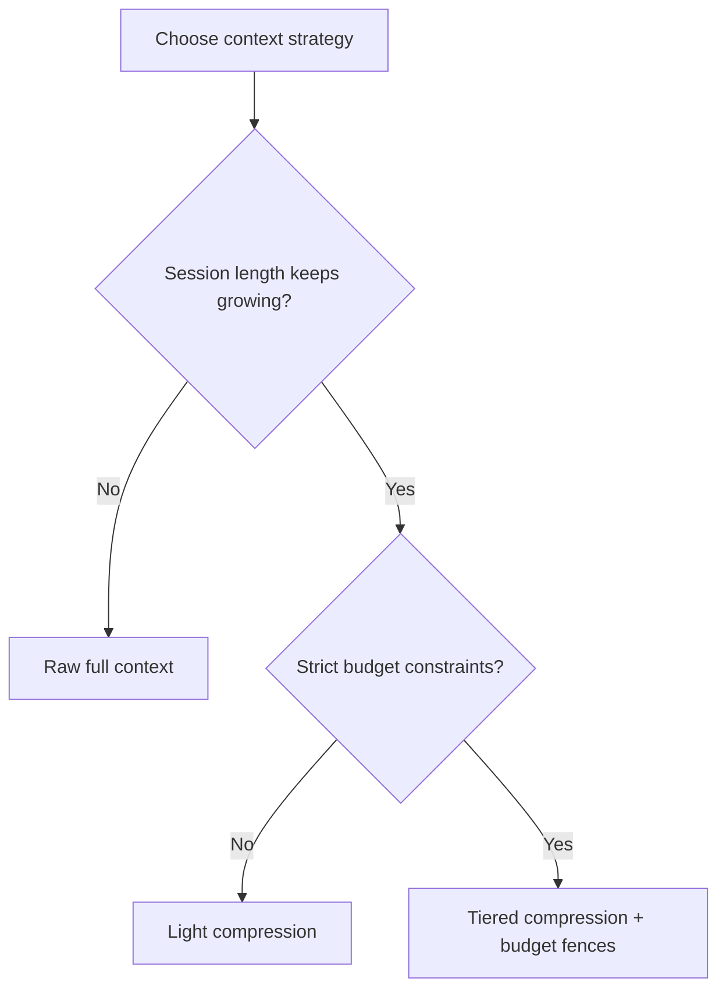
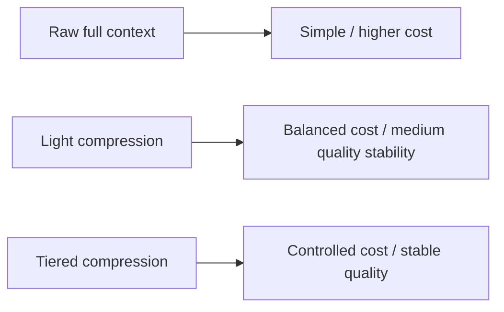
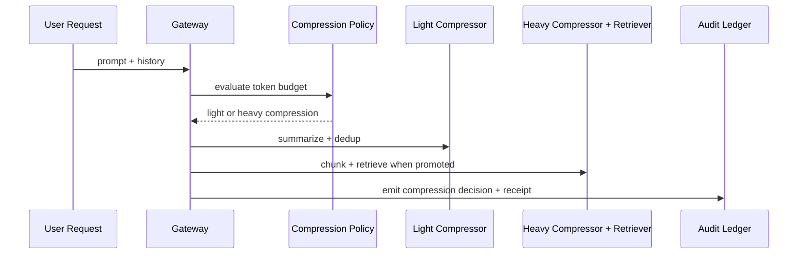

# Agent Context Compression Strategy FAQ (Raw Full Context vs Tiered Compression)

> Scope lock: this topic covers only **context-compression and token-budget governance** in agent runtime/gateway paths, not model vendor comparison.

## 1) 📌 Core conclusions at a glance (3 points)

1. **Long-chain agent workflows should default to tiered compression** to prevent token and latency blowups under concurrency.  
2. **Raw full-context forwarding is valid only for short sessions**: simplest implementation, weakest cost efficiency at scale.  
3. **Production baseline should be compression policy + budget fence + replay sampling** to hold both quality and cost.  

## 2) 🎯 Q1 / Q2 / Q3 (plain language + first principles)

### Q1: Why not send full context unchanged for every request?

- **Plain language**: if every turn includes the entire history, requests become slower and more expensive over time.  
- **First principle**: inference spend scales roughly linearly with input tokens; at concurrency, total cost multiplies rapidly.  

### Q2: When is simple/raw context still acceptable?

- Short conversations, narrow domain, low error impact;  
- Priority is minimal implementation complexity;  
- Business can tolerate higher token spend.  

### Q3: How does tiered context-compression governance work?

- **Plain language**: start with light compression, then promote to heavy compression + retrieval when budget or quality drifts.  
- **First principle**: govern information fidelity and token spend by risk tier, paying extra processing only when needed.  
- **Path**: request classification → light compression (summary + dedup) → drift trigger (budget breach / low confidence) → heavy compression (chunk + semantic retrieval) → audit receipt.  

## 3) 🧭 Mermaid views (TD decision tree + LR path + sequence)

## 4) 📊 Architect decision matrix

| Dimension | Raw full context | Light compression | Tiered compression (recommended) |
|---|---|---|---|
| Implementation complexity | Low | Medium | Medium-high |
| Token cost control | Low | Medium | High |
| Response stability | Medium | Medium | High |
| Quality-regression risk | Medium | Medium | Low |
| Default recommendation | ⚠ short sessions only | ✅ moderate scenarios | ✅ high-concurrency long chains |

## 5) 🧪 Quantitative example + 7-card insight

> Source of truth: `evidence/cycle-409-benchmark.json`.  
> Provenance labels: `measured` / `synthetic` / `anonymized_reported`; production paid-run metrics not executed are marked `not_measured`.

| Metric | Raw-context baseline | Tiered-compression baseline |
|---|---:|---:|
| Avg input tokens per session | 1.00x | 0.62x |
| P95 end-to-end latency | 241 ms | 188 ms |
| Budget-fence interception rate | 89.9% | 92.2% |
| Quality-stability score | 89.4 | 93.1 |
| Production billing reconciliation | `not_measured` | `not_measured` |

7-card deck: `benchmark-cards.en.html` / `benchmark-cards.html` (4:5, CSP self-contained, coordinates from this cycle's sealed evidence only)

## 6) 🛠️ Production validation checklist

- [ ] Define light/heavy compression promotion thresholds (budget, confidence, latency)
- [ ] Bind compression policy to tenant-level budget fences
- [ ] Prepare fallback path for heavy-compression lanes
- [ ] Persist compression decisions into MCP/A2A audit ledger
- [ ] Run periodic answer-consistency replay checks
- [ ] Monitor token, latency, and quality metrics together
- [ ] Publish evidence bundle (latency/throughput/policy/cost) for each release

