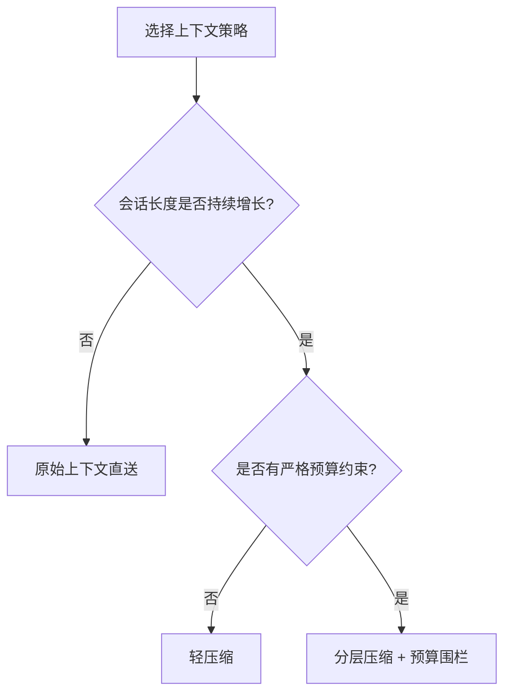
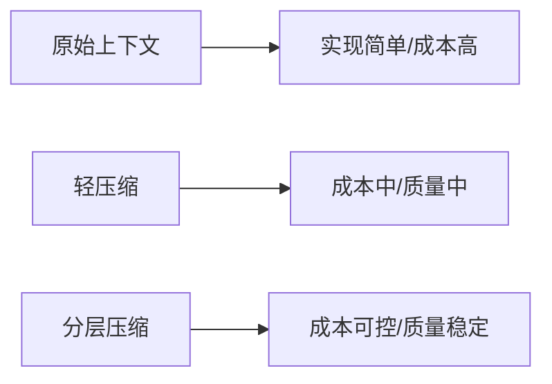
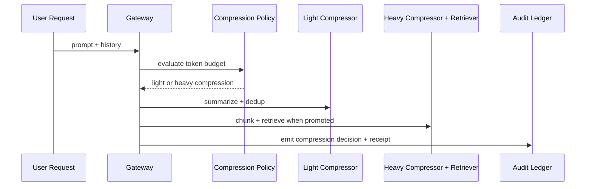

# Agent 上下文压缩策略选型 FAQ（原始上下文直送 vs 分层压缩）

> 专题边界：仅讨论 Agent Runtime/Gateway 的 **上下文压缩与 token 预算治理**，不扩展到模型供应商比较。

## 1) 📌 核心结论速览（3 条）

1. **长链路 Agent 默认需要分层压缩**，否则 token 成本和延迟会在并发时放大。  
2. **原始上下文直送只适合短轮次场景**：实现简单，但在复杂链路里性价比最低。  
3. **生产推荐“压缩策略 + 预算围栏 + 回放抽检”三件套**，同时守住质量与成本。  

## 2) 🎯 Q1 / Q2 / Q3（大白话 + 第一性原理）

### Q1：为什么不能所有请求都原样带全量上下文？

- **大白话**：每次都把“整本聊天记录”扔给模型，会越来越贵、越来越慢。  
- **第一性原理**：推理成本近似与输入 token 线性相关；并发下总成本按请求量成倍放大。  

### Q2：什么时候可以不做复杂压缩？

- 对话短、知识面窄、错误代价低；  
- 更关注极简实现而不是极致成本；  
- 业务可以接受较高 token 消耗。  

### Q3：核心机制 X（Tiered Context Compression）怎么工作？

- **大白话**：先做轻压缩，触发预算或质量漂移后再升级强压缩和检索增强。  
- **第一性原理**：把“信息保真”与“token 成本”分层治理，在风险上升时才支付更高处理开销。  
- **链路**：请求分类 → 轻压缩（摘要+去重）→ 漂移触发器（超预算/低置信度）→ 强压缩（分块+语义检索）→ 审计回执。  

## 3) 🧭 Mermaid（决策树 TD + 路径 LR + 时序）

## 4) 📊 架构师决策矩阵

| 维度 | 原始上下文直送 | 轻压缩 | 分层压缩（推荐） |
|---|---|---|---|
| 单次实现复杂度 | 低 | 中 | 中-高 |
| token 成本控制 | 低 | 中 | 高 |
| 响应稳定性 | 中 | 中 | 高 |
| 质量回归风险 | 中 | 中 | 低 |
| 默认建议 | ⚠ 仅短会话 | ✅ 中等场景 | ✅ 高并发长链路 |

## 5) 🧪 定量算例 + 7-Card 洞察

> 数据来源：`evidence/cycle-409-benchmark.json`。  
> 标签口径：`measured` / `synthetic` / `anonymized_reported`；未执行生产付费实验标 `not_measured`。

| 指标 | 原始上下文基线 | 分层压缩基线 |
|---|---:|---:|
| 每会话平均输入 token | 1.00x | 0.62x |
| P95 端到端延迟 | 241 ms | 188 ms |
| 预算围栏拦截率 | 89.9% | 92.2% |
| 质量稳定性评分 | 89.4 | 93.1 |
| 生产账单对账 | `not_measured` | `not_measured` |

7-card：`benchmark-cards.html` / `benchmark-cards.en.html`（4:5、自包含 CSP、坐标仅取本轮封存证据）

## 6) 🛠️ 生产核验 Checklist

- [ ] 定义轻压缩/强压缩升级阈值（预算、置信度、延迟）
- [ ] 把压缩策略绑定租户级预算围栏
- [ ] 为强压缩链路准备回退策略
- [ ] 将压缩决策写入 MCP/A2A 审计账本
- [ ] 周期抽检压缩前后答案一致性
- [ ] 监控 token、延迟、质量三类指标联动
- [ ] 发布时附证据包（latency/throughput/policy/cost）

