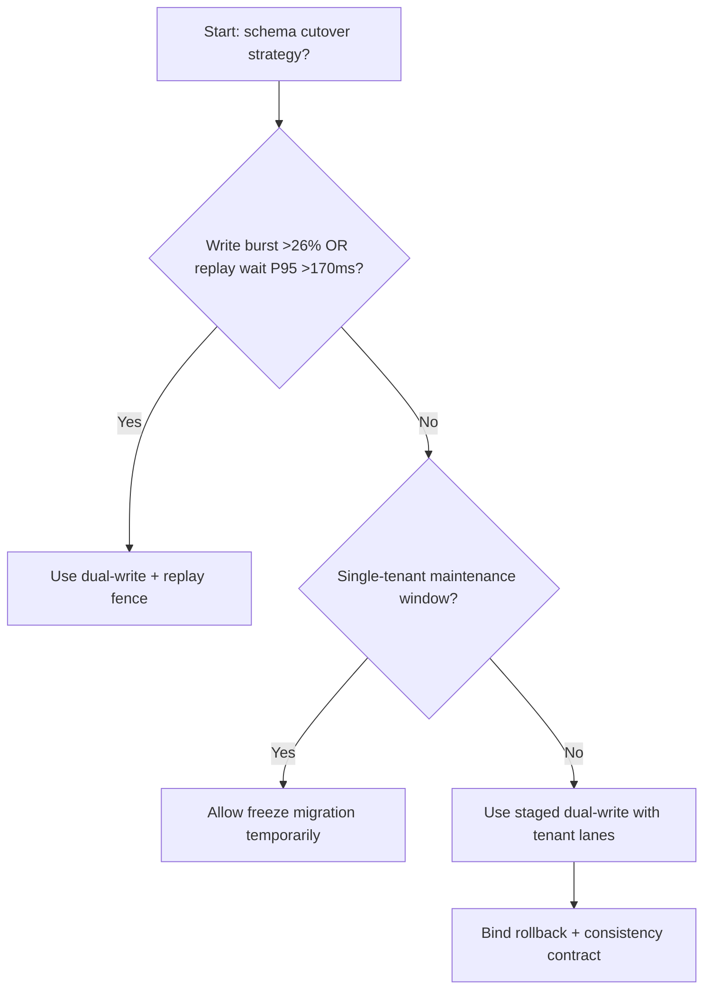
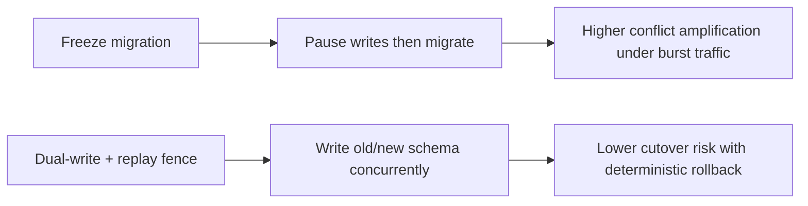
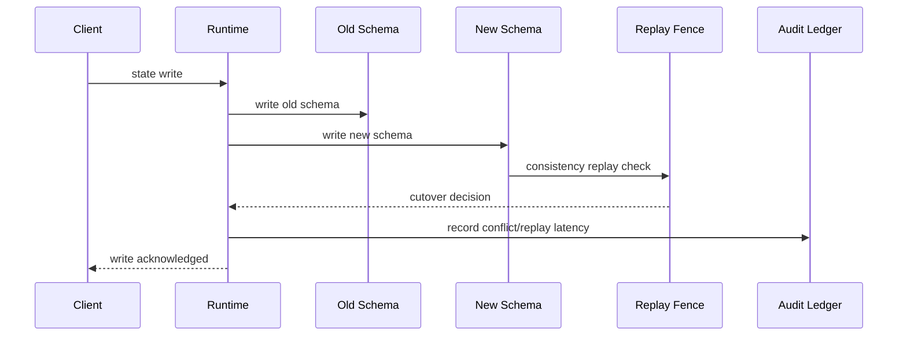

# Agent Control Plane Schema Dual-Write Cutover Selection FAQ (Freeze-the-world Migration vs Dual-Write + Replay Fence)

## 1) Core conclusions (for decision-makers first)
- **When control-plane write burst is >26% and replay-conflict wait P95 is >170ms, default to Dual-Write + Replay Fence** to avoid global-freeze migration drag.
- **When freeze-migration conflict rate exceeds 11% and failed-replay P95 exceeds 240ms, Freeze-the-world enters the 11.8% conflict amplification band**.
- **In multi-tenant production, bind dual-write, replay fence, and tenant-lane rollout as one policy unit**, or rollback windows become non-deterministic.

## 2) Q1 / Q2 / Q3 (plain-language definitions first)
- **Freeze-the-world Migration**: pause writes during schema migration; simpler but outage-sensitive.
- **Dual-Write + Replay Fence**: write old/new schema in parallel and cut over only after deterministic replay checks.

### Q1: Why does schema cutover directly affect agent availability?
First principles: control-plane state changes and scheduling are tightly coupled. Write freezes expand queues, and replay conflicts raise tail latency.

### Q2: When is Freeze-the-world acceptable temporarily?
Only in single-tenant low-traffic maintenance windows. Multi-tenant production should switch to dual-write fencing.

### Q3: What is the minimum safe loop?
Write sampling -> dual-write consistency checks -> replay fencing -> staged traffic switch -> rollback guard.

## 3) Mermaid (decision tree / path comparison / sequence)
### 3.1 Selection decision tree

### 3.2 Path comparison

### 3.3 Runtime sequence

## 4) Decision matrix
| Dimension | Freeze-the-world Migration | Dual-Write + Replay Fence |
|---|---|---|
| Implementation complexity | Low | Medium-High |
| Migration interruption risk | High | Low |
| Multi-tenant controllability | Low | High |
| Rollback determinism | Medium | High |
| Default production fit | Maintenance windows only | Long-term default |

## 5) Evidence contract + recomputable examples (n/denominator/source)
> Percentages in this section are `synthetic_assumed` hypothetical examples for mechanism comparison; production mechanism validation remains `not_measured`.  
> Contract fields: `workshops/azure-agent-infra/evidence/cycle-541-benchmark.json` -> `percentage_contract`.

- Metric A (freeze-migration conflict rate)  
  - Formula: `n_freeze_migration_conflicts / n_gateway_requests_observed`  
  - Value: `521/4410 = 11.8%` (`synthetic_assumed`)  
  - Path: `percentage_contract.freeze_migration_conflict_rate`
- Metric B (dual-write conflict rate)  
  - Formula: `n_dual_write_conflicts / n_gateway_requests_observed`  
  - Value: `203/4410 = 4.6%` (`synthetic_assumed`)  
  - Path: `percentage_contract.dual_write_conflict_rate`
- Metric C (recovery gain, percentage points)  
  - Formula: `(n_recovered_dual_write - n_recovered_freeze) / n_gateway_requests_observed`  
  - Value: `(4092-3774)/4410 = 7.2 percentage points` (`synthetic_assumed`)  
  - Path: `percentage_contract.dual_write_recovery_gain_pts`

## 6) Production checklist
- [ ] Every tenant has migration windows, dual-write budgets, and rollback thresholds
- [ ] Conflict rate, replay wait, and cutover success are observable and auditable
- [ ] Change flow supports canary rollout, rollback, and tiered promotion
- [ ] All metrics are tagged `synthetic_assumed`; production validation remains `not_measured`
