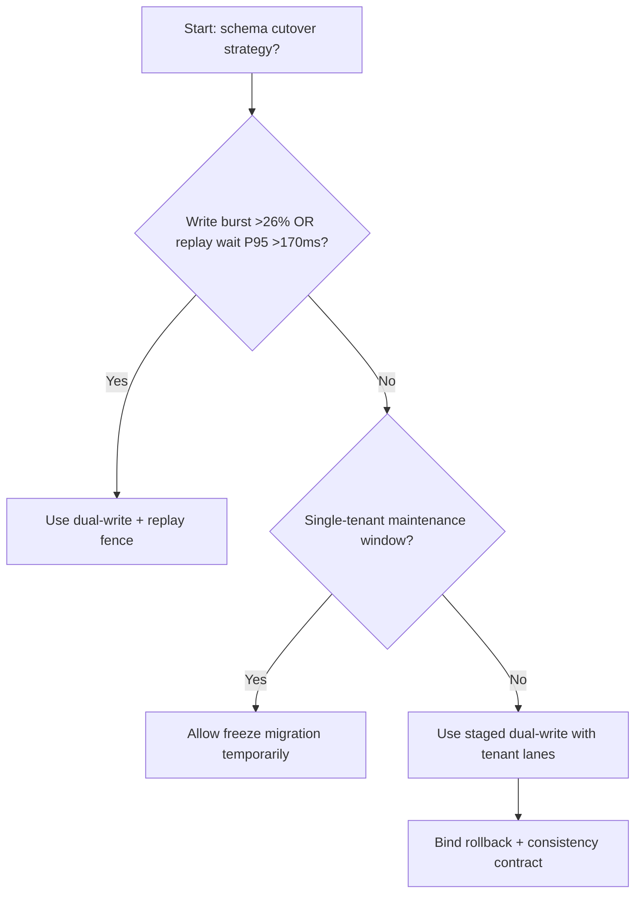
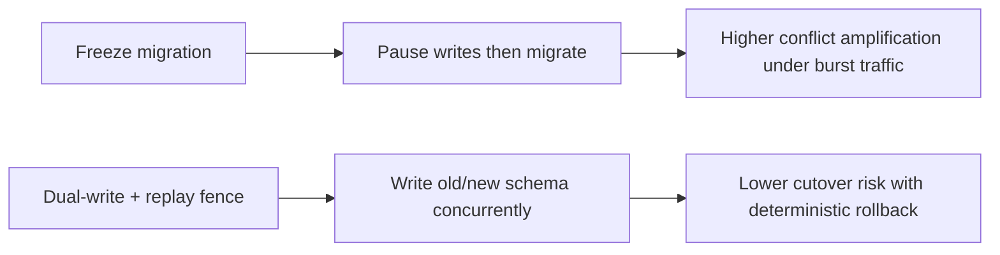
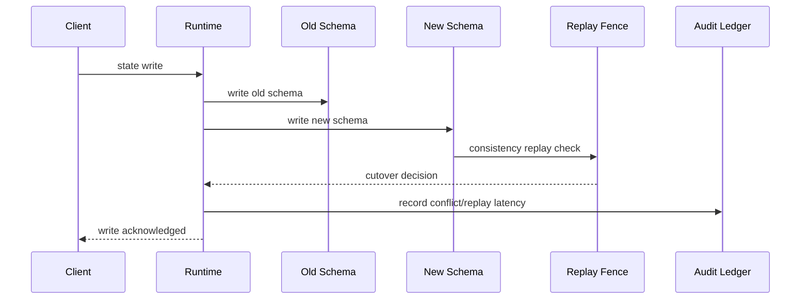

# Agent Control Plane Schema Dual-Write Cutover 选型 FAQ（Freeze-the-world Migration vs Dual-Write + Replay Fence）

## 1) 核心结论（先给负责人）
- **当控制面写流峰值 >26% 且迁移冲突回放等待 P95 >170ms 时，默认应选 Dual-Write + Replay Fence**，避免全局冻结迁移拖慢业务。
- **当冻结迁移冲突率 >11% 且失败重放 P95 >240ms 时，Freeze-the-world 路径会进入 11.8% 冲突放大区间**。
- **多租户生产切换必须把“写双发、回放围栏、租户分段放量”绑定执行**，否则回滚窗口不可控。

## 2) Q1 / Q2 / Q3（术语先通俗解释）
- **Freeze-the-world Migration**：迁移时短时冻结写入，逻辑简单但中断敏感。
- **Dual-Write + Replay Fence**：新旧 schema 并行写入，并用回放围栏校验一致性后切换。

### Q1：为什么 schema 切换会直接打到 Agent 可用性？
第一性原理：控制面状态变更与任务调度强耦合。冻结写入会扩大排队，冲突重放会拉高尾时延。

### Q2：什么时候可以临时用 Freeze-the-world？
仅限单租户低流量维护窗；进入多租户生产必须切换到双写围栏。

### Q3：最小闭环是什么？
写入采样 -> 双写一致性比对 -> 回放围栏 -> 分段切流 -> 失败回滚。

## 3) Mermaid（决策树 / 路径对比 / 时序）
### 3.1 选型决策树

### 3.2 路径对比图

### 3.3 运行时序图

## 4) 选型决策矩阵
| 维度 | Freeze-the-world Migration | Dual-Write + Replay Fence |
|---|---|---|
| 实现复杂度 | 低 | 中-高 |
| 迁移中断风险 | 高 | 低 |
| 多租户可控性 | 低 | 高 |
| 回滚确定性 | 中 | 高 |
| 生产默认建议 | 仅维护窗 | 长期默认 |

## 5) 数据证据与可复算算例（含 n/分母/来源）
> 本节百分比为 `synthetic_assumed` 假设算例（hypothetical），用于机制比较；生产机制认证保持 `not_measured`。  
> 合同字段见：`workshops/azure-agent-infra/evidence/cycle-541-benchmark.json` 的 `percentage_contract`。

- 指标 A（冻结迁移冲突率）  
  - 定义：`n_freeze_migration_conflicts / n_gateway_requests_observed`  
  - 值：`521/4410 = 11.8%`（`synthetic_assumed`）  
  - 路径：`percentage_contract.freeze_migration_conflict_rate`
- 指标 B（双写冲突率）  
  - 定义：`n_dual_write_conflicts / n_gateway_requests_observed`  
  - 值：`203/4410 = 4.6%`（`synthetic_assumed`）  
  - 路径：`percentage_contract.dual_write_conflict_rate`
- 指标 C（恢复增益，百分点）  
  - 定义：`(n_recovered_dual_write - n_recovered_freeze) / n_gateway_requests_observed`  
  - 值：`(4092-3774)/4410 = 7.2` 个百分点（`synthetic_assumed`）  
  - 路径：`percentage_contract.dual_write_recovery_gain_pts`

## 6) 生产 Checklist（上线前必须打勾）
- [ ] 每租户有迁移窗口、双写预算与回滚阈值
- [ ] 冲突率、回放等待、切流成功率可观测可审计
- [ ] 变更支持灰度、回退与分层放量
- [ ] 指标全部标注 `synthetic_assumed`，生产机制认证保持 `not_measured`
