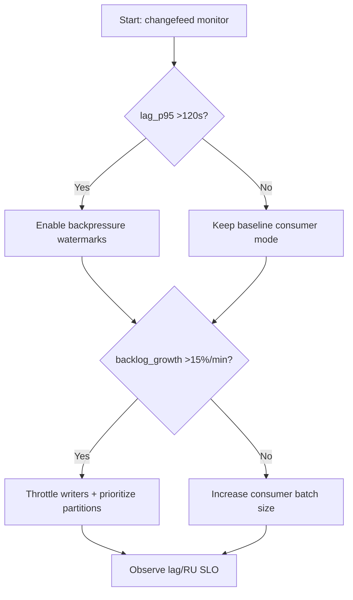
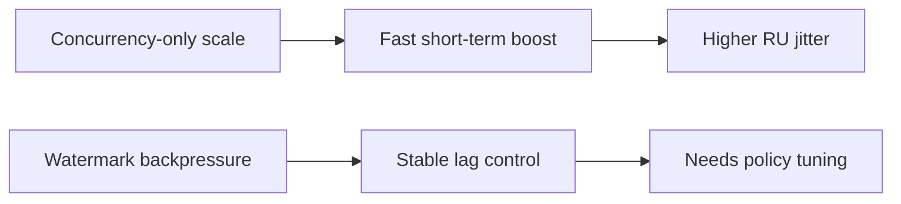
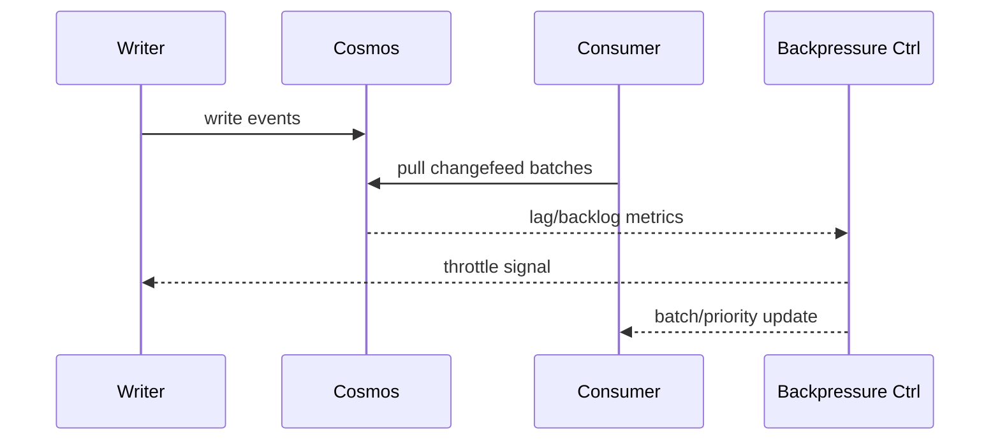

# Agent Cosmos Changefeed Backpressure Watermark Selection FAQ (Azure AI Agent Infra)

## 1) 3-minute conclusions
- **If changefeed lag exceeds 120s and backlog growth exceeds 15%/min, enforce backpressure watermarks with tiered consumption.**
- **Concurrency-only scaling amplifies RU jitter; stabilize write throttles and batch windows first.**
- **Targets: `lag_p95 <45s`, `backlog_growth <3%/min`, `RU_throttle <0.8%`.**

## 2) Q1 / Q2 / Q3
- **Why does backlog keep growing?** Write bursts and consumer pace are mismatched.
- **Why watermarks?** They trigger controlled slowdown before collapse.
- **Minimum viable loop?** High/low watermarks, batch windows, partition priorities, auto fallback.

### Q1: When must writer throttling start?
When high-watermark remains triggered and RU-throttle alerts rise.

### Q2: When can consumer concurrency increase?
Stable low-watermark with controlled hotspot distribution.

### Q3: How to measure gain?
Compare lag recovery speed versus throughput tradeoff.

## 3) Mermaid diagrams
### 3.1 Decision tree

### 3.2 Path comparison

### 3.3 Sequence

## 4) Decision matrix
| Dimension | Concurrency-only scale | Watermark backpressure (Recommended) |
|---|---:|---:|
| Lag control | Medium | High |
| RU jitter | High | Medium-low |
| Throughput stability | Medium | High |
| Ops complexity (1-10) | 4 | 7 |
| Recoverability | Medium | High |

## 5) Quant model + 7-card insights
- Backlog pressure: `BacklogPressure = BacklogDelta / BacklogBase`
- Catch-up gain: `CatchupGain = BaselineLag - NewLag`
- Example (`synthetic_assumed`):
  - `BacklogDelta=18,000, BacklogBase=120,000`
  - `BacklogPressure=15%`
  - `BaselineLag=146s, NewLag=52s`
  - `CatchupGain=94s`
- Evidence:
  - `workshops/azure-agent-infra/evidence/cycle-1468-benchmark.json`
  - `workshops/azure-agent-infra/evidence/cycle-1468-sources.json`
- Labels: `official/synthetic_assumed/not_measured`.

## 6) Production verification checklist
- [ ] High/low watermark thresholds and auto-actions are configured
- [ ] Writer throttling and consumer batching policies are linked
- [ ] Partition hotspot priority rules are active
- [ ] lag/backlog/RU alerts are traceable
- [ ] FAQ/7-card source labels are complete
