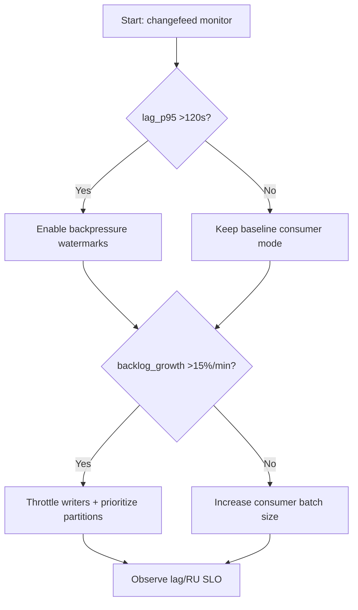
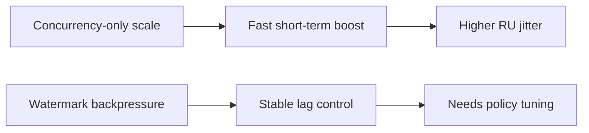
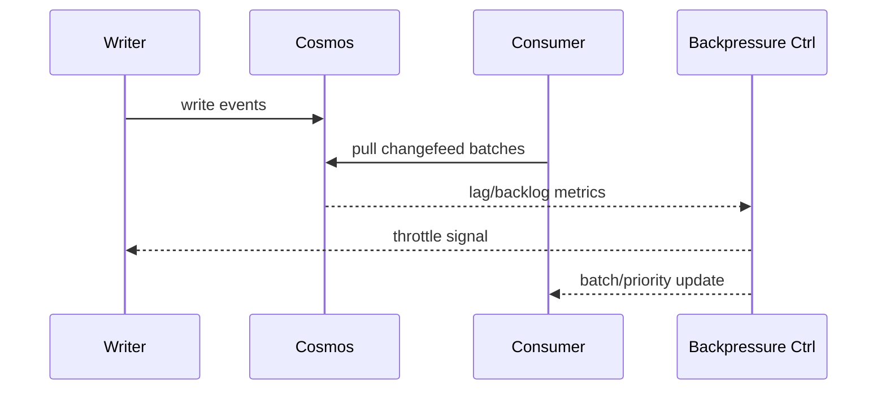

# Agent Cosmos Changefeed Backpressure Watermark 选型 FAQ（Azure AI Agent Infra）

## 1) 3 分钟结论
- **当 changefeed 延迟 >120s 且积压增长率 >15%/min 时，必须启用背压水位线和分层消费。**
- **仅加消费并发会放大 RU 抖动；应先稳定写入节流与批量窗口。**
- **生产阈值：`lag_p95 <45s`、`backlog_growth <3%/min`、`RU_throttle <0.8%`。**

## 2) Q1 / Q2 / Q3
- **为什么积压会越追越多？**：写入峰值和消费节奏失配。
- **为什么要水位线？**：在临界前触发降速/分流，避免雪崩。
- **最小闭环？**：高低水位、批量窗口、分区优先级、自动回落。

### Q1：何时必须降载写入？
当高水位连续触发且 RU throttle 告警上升。

### Q2：何时可提并发？
低水位稳定且分区热点受控。

### Q3：如何评估收益？
比较延迟回落速度与吞吐损失。

## 3) Mermaid 图
### 3.1 决策树

### 3.2 路径对比

### 3.3 时序

## 4) 决策矩阵
| 维度 | 仅提并发 | 水位线背压（推荐） |
|---|---:|---:|
| lag 控制 | 中 | 高 |
| RU 抖动 | 高 | 中低 |
| 吞吐稳定性 | 中 | 高 |
| 运维复杂度（1-10） | 4 | 7 |
| 可恢复性 | 中 | 高 |

## 5) 定量算例与 7-Card 洞察
- 积压压力：`BacklogPressure = BacklogDelta / BacklogBase`
- 追平收益：`CatchupGain = BaselineLag - NewLag`
- 示例（`synthetic_assumed`）：
  - `BacklogDelta=18,000, BacklogBase=120,000`
  - `BacklogPressure=15%`
  - `BaselineLag=146s, NewLag=52s`
  - `CatchupGain=94s`
- 证据：
  - `workshops/azure-agent-infra/evidence/cycle-1468-benchmark.json`
  - `workshops/azure-agent-infra/evidence/cycle-1468-sources.json`
- 标签：`official/synthetic_assumed/not_measured`。

## 6) 生产核验 Checklist
- [ ] 高低水位阈值与自动动作已配置
- [ ] 写入节流与消费批量策略联动
- [ ] 分区热点优先级规则生效
- [ ] lag/backlog/RU 三指标告警可追溯
- [ ] FAQ/7-Card 来源标签完整
