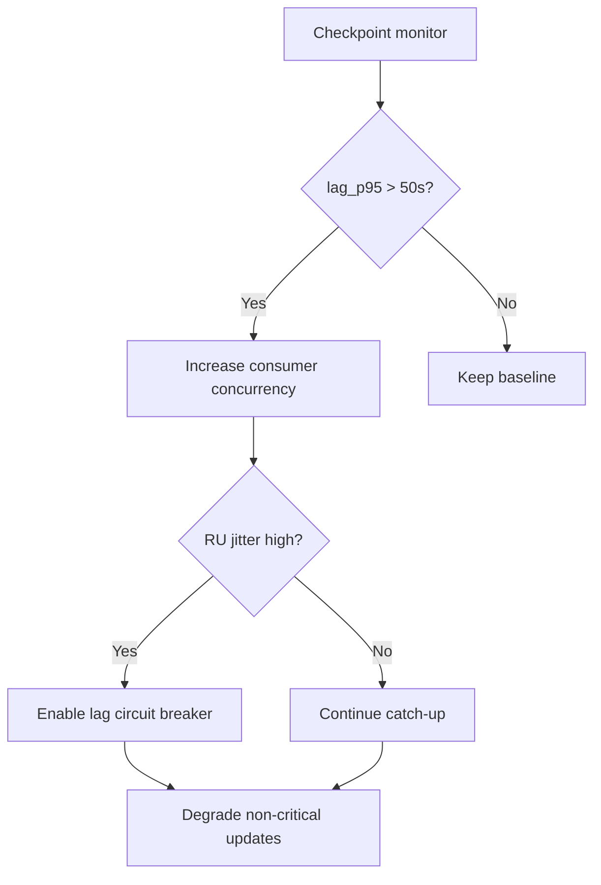
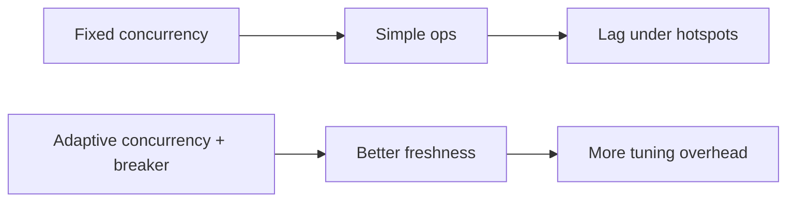
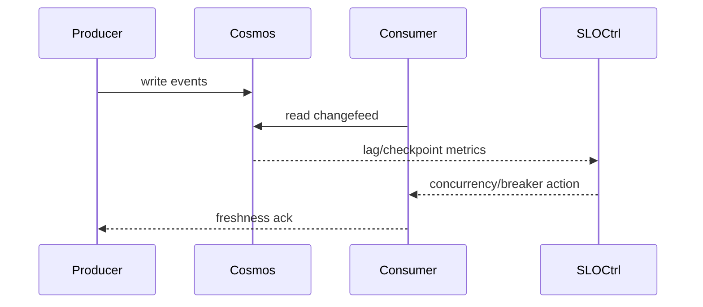

# Agent Cosmos Changefeed Checkpoint Lag SLO Selection FAQ (Azure AI Agent Infra)

## 1) 3-minute conclusions
- **Without checkpoint-lag SLO guardrails, Cosmos changefeed can make downstream Agent state stale.**
- **Use partition lag-percentile monitoring + adaptive concurrency + lag circuit breaker.**
- **Targets: `lag_p95 <50s`, `stale_state_rate <0.6%`, `recovery_window <8m`.**

## 2) Q1 / Q2 / Q3
- **Why lag keeps growing?** Hot partitions and consumer concurrency mismatch.
- **Why not just increase concurrency?** It can amplify RU jitter and retry storms.
- **Minimum loop?** Lag monitoring, concurrency tuning, breaker fallback.

### Q1: When to trigger breaker?
When lag stays above threshold and stale-state alerts rise.

### Q2: When to return to normal mode?
When lag stabilizes and retries drop.

### Q3: How to validate gain?
Compare freshness improvement versus throughput tradeoff.

## 3) Mermaid diagrams
### 3.1 Decision tree

### 3.2 Path comparison

### 3.3 Sequence

## 4) Decision matrix
| Dimension | Fixed concurrency | Adaptive + breaker (Recommended) |
|---|---:|---:|
| Freshness | Medium | High |
| Stability | Medium | High |
| Ops complexity (1-10) | 4 | 8 |
| Cost control | Medium | Medium-high |
| Recovery speed | Medium | High |

## 5) Quant model + 7-card insights
- Freshness gain: `FreshGain = BaselineLagP95 - GuardedLagP95`
- Stale rate: `StaleRate = StaleStates / TotalStates`
- Example (`synthetic_assumed`):
  - `BaselineLagP95=132s, GuardedLagP95=46s`
  - `FreshGain=86s`
  - `StaleStates=510, TotalStates=96,000`
  - `StaleRate=0.53%`
- Evidence:
  - `workshops/azure-agent-infra/evidence/cycle-1481-benchmark.json`
  - `workshops/azure-agent-infra/evidence/cycle-1481-sources.json`
- Labels: `official/synthetic_assumed/not_measured`.

## 6) Production verification checklist
- [ ] lag_p95 and stale-state alerts are linked
- [ ] Adaptive concurrency policy and caps are configurable
- [ ] Breaker downgrade path load tests pass
- [ ] recovery_window is observable and replayable
- [ ] FAQ/7-card source labels are complete
