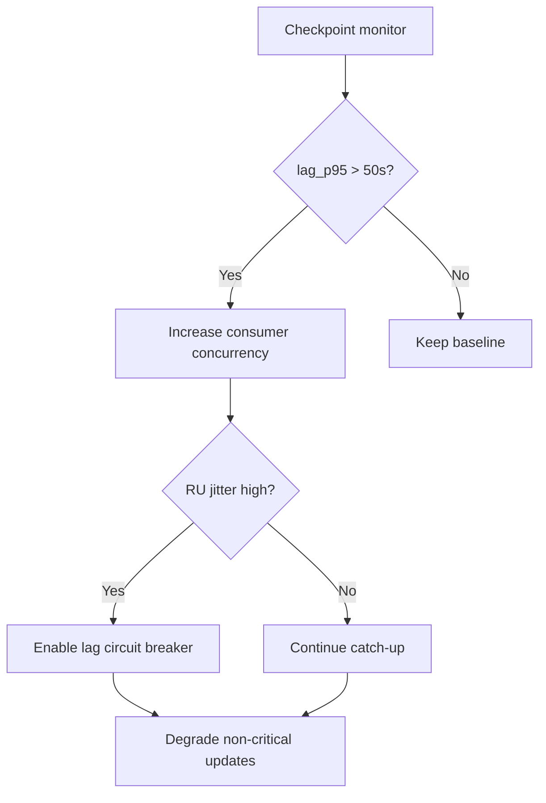
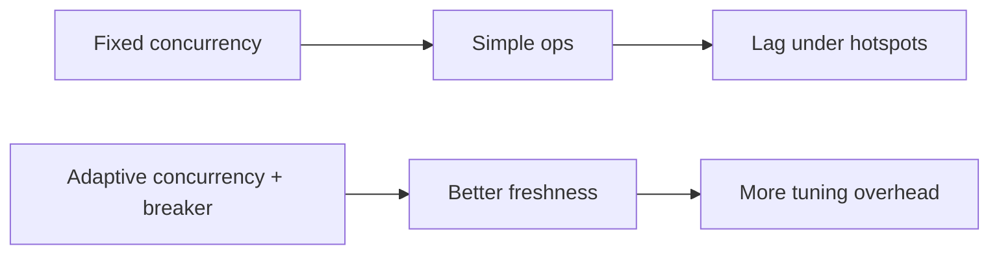
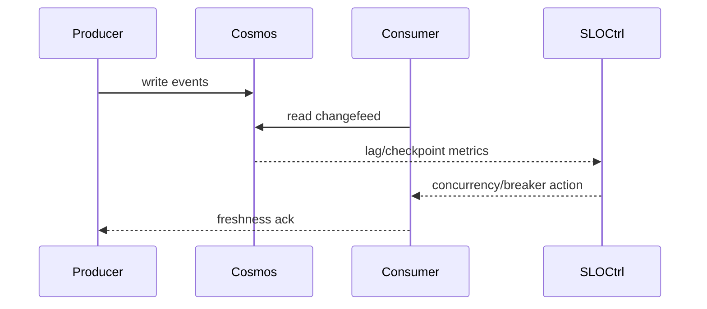

# Agent Cosmos Changefeed Checkpoint Lag SLO 选型 FAQ（Azure AI Agent Infra）

## 1) 3 分钟结论
- **Cosmos changefeed 若 checkpoint lag 缺少 SLO 护栏，会导致下游 Agent 状态陈旧。**
- **推荐“分区 lag 分位监控 + 动态并发 + 滞后熔断降级”闭环。**
- **目标阈值：`lag_p95 <50s`、`stale_state_rate <0.6%`、`recovery_window <8m`。**

## 2) Q1 / Q2 / Q3
- **为何 lag 会持续扩大？**：热点分区与消费者并发不匹配。
- **为何不能只提并发？**：可能放大 RU 抖动与重试风暴。
- **最小闭环？**：lag 监控、并发调节、熔断回落。

### Q1：何时触发熔断？
lag 连续超阈值且 stale_state 告警上升。

### Q2：何时恢复常态？
lag 指标稳定回落且重试率下降。

### Q3：如何验证收益？
比较状态新鲜度与吞吐损失。

## 3) Mermaid 图
### 3.1 决策树

### 3.2 路径对比

### 3.3 时序

## 4) 决策矩阵
| 维度 | 固定并发 | 自适应+熔断（推荐） |
|---|---:|---:|
| 新鲜度 | 中 | 高 |
| 稳定性 | 中 | 高 |
| 运维复杂度（1-10） | 4 | 8 |
| 成本可控 | 中 | 中高 |
| 故障恢复 | 中 | 高 |

## 5) 定量算例与 7-Card 洞察
- 新鲜度收益：`FreshGain = BaselineLagP95 - GuardedLagP95`
- 陈旧率：`StaleRate = StaleStates / TotalStates`
- 示例（`synthetic_assumed`）：
  - `BaselineLagP95=132s, GuardedLagP95=46s`
  - `FreshGain=86s`
  - `StaleStates=510, TotalStates=96,000`
  - `StaleRate=0.53%`
- 证据：
  - `workshops/azure-agent-infra/evidence/cycle-1481-benchmark.json`
  - `workshops/azure-agent-infra/evidence/cycle-1481-sources.json`
- 标签：`official/synthetic_assumed/not_measured`。

## 6) 生产核验 Checklist
- [ ] lag_p95 与 stale_state 告警联动
- [ ] 动态并发策略与上限可配置
- [ ] 熔断降级路径压测通过
- [ ] recovery_window 可观测与回放
- [ ] FAQ/7-Card 来源标签完整
