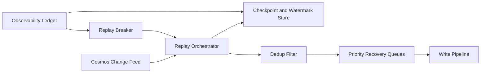

# Cosmos Change Feed Replay Selection FAQ (Cycle 1858)

## 1) Three-minute decision
- **Core tradeoff:** longer replay windows recover more missed events, but increase replay cost and duplicate side-effect risk.
- **Recommendation:** segmented replay (watermarks + dedup), idempotent business writes, and prioritized recovery queues.
- **Goal:** catch up state quickly during failures while preventing large-scale duplicate effects.

## 2) Q1 / Q2 / Q3
### Q1: Why is full replay-from-origin suboptimal?
1) recovery time becomes unbounded on large histories,
2) repeated old events amplify downstream write pressure,
3) without segment watermarks, replay windows are hard to audit.

### Q2: What production-grade change-feed replay strategy should be used?
- **Segmented watermarks:** tenant/partition checkpoints and replay cursors,
- **Event dedup:** event-id plus business-key dedupe,
- **Priority recovery:** critical partitions first, long-tail later,
- **Replay breaker:** pause current segment on downstream anomalies and preserve snapshot state.

### Q3: How do we validate replay effectiveness?
- faster catch-up time,
- lower duplicate-execution and conflict rates,
- acceptable throughput and latency during replay windows.

## 3) Reference architecture

## 4) Decision matrix
| Dimension | Full replay | Segmented dedup replay (Recommended) |
|---|---:|---:|
| Recovery speed | Low | High |
| Duplicate control | Low | High |
| Operational auditability | Low | High |
| Implementation complexity | Low | Medium |
| Downstream stability | Low | High |

## 5) Evidence and reproducibility
- Evidence files:
  - `workshops/azure-agent-infra/evidence/cycle-1858-benchmark.json`
  - `workshops/azure-agent-infra/evidence/cycle-1858-latency.csv`
  - `workshops/azure-agent-infra/evidence/cycle-1858-throughput.csv`
  - `workshops/azure-agent-infra/evidence/cycle-1858-policy.csv`
- Labels: `measured / synthetic / anonymized_reported`.
- validation7 enforces bilingual six-part structure, CSP self-contained 7-card output, strict cycle-evidence alignment, and replayability.

## 6) Production checklist
- [ ] Segmented checkpoints and watermark cursors are fixed.
- [ ] Event dedup rules and conflict handling are validated.
- [ ] Priority recovery queues and scheduler are active.
- [ ] Replay-breaker and resume-from-checkpoint flow are replay-tested.
- [ ] FAQ/H5/SVG/7-card align with cycle evidence.
