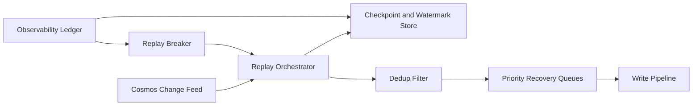

# Cosmos Change Feed 回放选型 FAQ（Cycle 1858）

## 1) 3 分钟结论
- **核心矛盾：** 回放窗口越长越能补齐丢失事件，但会增加重放成本与重复执行风险。
- **推荐：** 分段回放（水位点 + 事件去重）+ 业务幂等写入 + 优先级恢复队列。
- **目标：** 在故障恢复时快速追平状态，同时避免大规模重复副作用。

## 2) Q1 / Q2 / Q3
### Q1：为什么“全量从头回放”不可取？
1) 历史事件量大时恢复时间不可控；
2) 旧事件重复处理会放大下游写放大；
3) 缺少分段水位会导致恢复窗口难以审计。

### Q2：生产级 Change Feed 回放策略如何设计？
- **分段水位：** 以租户/分区维护 checkpoint 与重放游标；
- **事件去重：** 基于 event-id + 业务键防重复执行；
- **优先级恢复：** 关键业务分区先回放，长尾延后；
- **回放熔断：** 下游异常时暂停当前分段并保留状态快照。

### Q3：如何验证回放链路有效？
- 恢复追平时间明显缩短；
- 重复执行率和冲突率下降；
- 回放期间系统吞吐与延迟保持在可接受区间。

## 3) 架构图

## 4) 选型矩阵
| 维度 | 全量回放 | 分段去重回放（推荐） |
|---|---:|---:|
| 恢复速度 | 低 | 高 |
| 重复执行控制 | 低 | 高 |
| 运维可审计性 | 低 | 高 |
| 实施复杂度 | 低 | 中 |
| 下游稳定性 | 低 | 高 |

## 5) 证据与复算口径
- 证据文件：
  - `workshops/azure-agent-infra/evidence/cycle-1858-benchmark.json`
  - `workshops/azure-agent-infra/evidence/cycle-1858-latency.csv`
  - `workshops/azure-agent-infra/evidence/cycle-1858-throughput.csv`
  - `workshops/azure-agent-infra/evidence/cycle-1858-policy.csv`
- 标签：`measured / synthetic / anonymized_reported`。
- validation7：双语六段结构、7-card CSP 自包含、轮次与 evidence 一致、可回放链路通过。

## 6) 生产检查清单
- [ ] 分段 checkpoint 与水位游标策略已固化。
- [ ] 事件去重规则与冲突处理已验证。
- [ ] 优先级恢复队列与调度策略生效。
- [ ] 回放熔断与断点恢复流程可回放。
- [ ] FAQ/H5/SVG/7-card 与 evidence 轮次一致。
