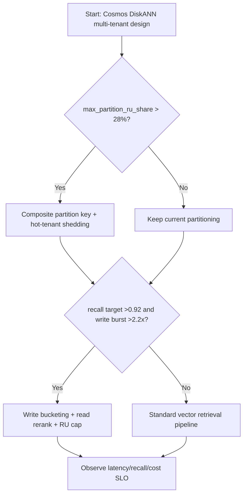
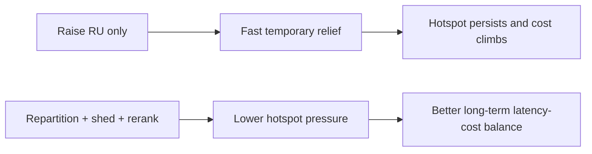
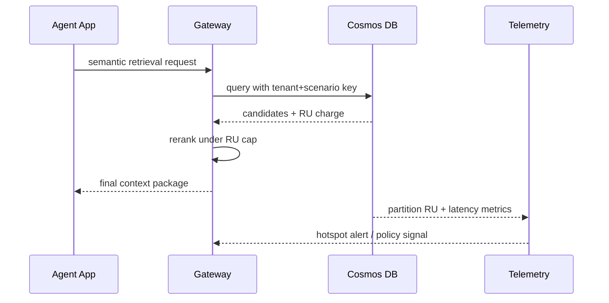

# Agent Cosmos DB DiskANN Hot Partition RU Budget Isolation Selection FAQ (Azure AI Agent Infra)

## 1) 3-minute conclusions
- **If single-partition RU share stays above 28% and query P95 exceeds 240ms, move from tenant-only partitioning to composite tenant+scenario keys with hotspot shedding**.
- **If DiskANN recall target exceeds 0.92 and write bursts exceed 2.2x, prefer write bucketing plus read-side rerank** rather than just increasing per-partition RU.
- **Production default: cap hotspots first, stabilize recall second, optimize cost third**. RU-only scaling is a short-term patch.

## 2) Q1 / Q2 / Q3
- **Why do hotspots keep returning?** Tenant traffic skew concentrates RU on a few partitions.
- **Why does DiskANN amplify it?** Index maintenance plus high-QPS vector queries inflate both tail latency and RU spikes.
- **Minimum viable loop?** Partition modeling, hotspot detection, shedding policy, query downgrade, and cost telemetry.

### Q1: When must partition keys be redesigned?
When `max_partition_ru_share > 28%` for 3 consecutive 10-minute windows.

### Q2: When is throttling-only acceptable?
Short marketing bursts under 30 minutes can start with throttling and observation.

### Q3: How to balance recall and cost?
Two-stage retrieval: high-recall coarse stage, then constrained rerank with RU cap per request.

## 3) Mermaid diagrams
### 3.1 Decision tree

### 3.2 Path comparison

### 3.3 Sequence

## 4) Decision matrix
| Dimension | RU-only scale-up | Repartition + shedding + rerank (Recommended) |
|---|---:|---:|
| P95 latency | 210–320ms (short-term) | 140–230ms (steady-state) |
| Hot-partition RU share | 25–40% | 12–24% |
| Recall target range | 0.88–0.93 | 0.90–0.95 |
| Session cost | Medium-high | Medium |
| Ops complexity (1-10) | 5 | 8 |
| Long-term sustainability | Low | High |

## 5) Quant model + 7-card insight
- Hotspot share: `HotShare = MaxPartitionRU / TotalRU`
- Per-request cost: `ReqCost = RUCharge * RUPrice`
- Example (`synthetic_assumed`):
  - `MaxPartitionRU=8,400 RU/s, TotalRU=26,000 RU/s`
  - `HotShare=32.3%`
  - `RUCharge=48, RUPrice=$0.000008`
  - `ReqCost=$0.000384`
- Evidence pointers:
  - `workshops/azure-agent-infra/evidence/cycle-1449-benchmark.json`
  - `workshops/azure-agent-infra/evidence/cycle-1449-sources.json`
- Labels: `official`, `synthetic_assumed`, `not_measured`.

## 6) Production verification checklist
- [ ] Partition key includes tenant + scenario and migration/backfill plan is tested
- [ ] Hot-tenant shedding policy is dynamically switchable
- [ ] DiskANN retrieval and rerank RU caps are enforced
- [ ] Metrics cover RU share, P95/P99, recall, and cost curves
- [ ] FAQ and 7-card include source timestamps and label boundaries
