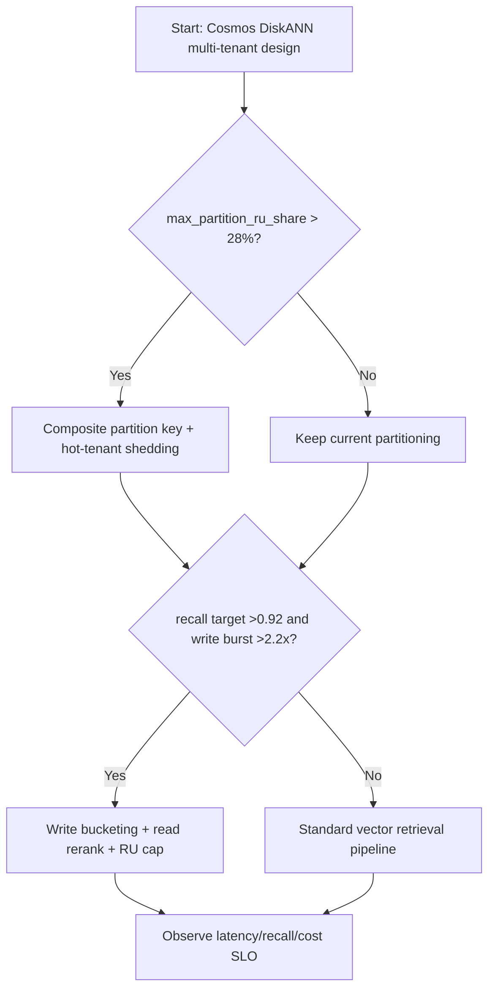
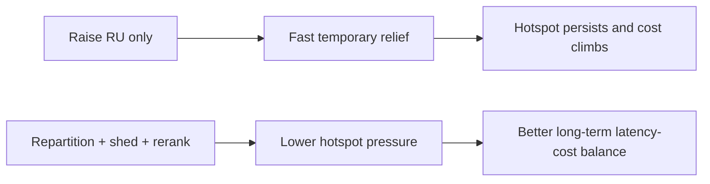
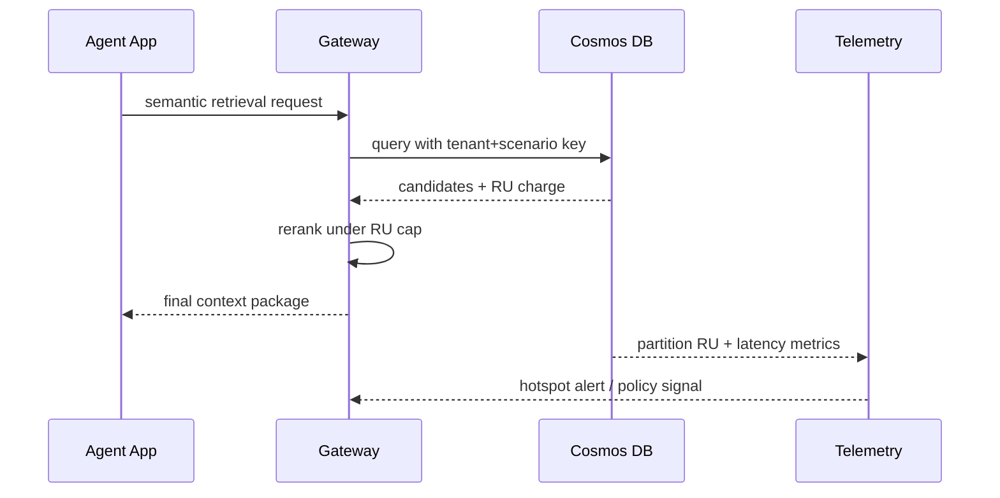

# Agent Cosmos DB DiskANN Hot Partition RU Budget Isolation 选型 FAQ（Azure AI Agent Infra）

## 1) 3 分钟核心结论
- **当单分区 RU 消耗占比持续 >28% 且 P95 查询延迟 >240ms 时，必须从“租户键直切分”升级到“租户+场景复合分区键 + 热分区降载”**。
- **当向量检索（DiskANN）召回目标 >0.92 且写入突增 >2.2x 时，优先“写入分桶 + 读侧 rerank”**，不要直接提高单分区 RU 上限。
- **生产默认：先限热点，再稳召回，再控成本**；纯扩容 RU 是短期止血，不是长期结构化解法。

## 2) Q1 / Q2 / Q3
- **为什么热点会反复出现？**：租户流量分布高度偏斜，单热点租户吞掉大部分 RU。
- **为什么 DiskANN 会放大问题？**：向量索引重构与高并发查询叠加，导致尾延迟和 RU 峰值同时上升。
- **最小闭环怎么建？**：分区建模、热点探测、限流降载、查询降级、成本追踪一体化。

### Q1：什么时候必须重建分区键？
当连续 3 个观测窗口（每 10 分钟）`max_partition_ru_share > 28%`。

### Q2：什么时候可以只做限流？
短时营销峰值且持续时间 <30 分钟，可先限流再观察。

### Q3：如何平衡召回和成本？
设置两级检索：一级高召回粗筛，二级小样本 rerank，限制每请求 RU 上限。

## 3) Mermaid 图
### 3.1 决策树

### 3.2 路径对比

### 3.3 时序

## 4) 选型决策矩阵
| 维度 | 仅扩 RU | 复合分区+热点降载+Rerank（推荐） |
|---|---:|---:|
| P95 延迟 | 210–320ms（短期） | 140–230ms（稳态） |
| 热分区 RU 占比 | 25–40% | 12–24% |
| 召回率（目标） | 0.88–0.93 | 0.90–0.95 |
| 单会话成本 | 中高 | 中 |
| 运维复杂度（1-10） | 5 | 8 |
| 长期可持续性 | 低 | 高 |

## 5) 定量算例与 7-Card 洞察
- 热点比：`HotShare = MaxPartitionRU / TotalRU`
- 单请求成本：`ReqCost = RUCharge * RUPrice`
- 示例（`synthetic_assumed`）：
  - `MaxPartitionRU=8,400 RU/s, TotalRU=26,000 RU/s`
  - `HotShare=32.3%`
  - `RUCharge=48, RUPrice=$0.000008`
  - `ReqCost=$0.000384`
- 证据文件：
  - `workshops/azure-agent-infra/evidence/cycle-1449-benchmark.json`
  - `workshops/azure-agent-infra/evidence/cycle-1449-sources.json`
- 标签：`official`、`synthetic_assumed`、`not_measured`。

## 6) 生产核验 Checklist
- [ ] 分区键已含 tenant + scenario 维度并完成回填策略
- [ ] 热租户限流/降载策略可动态开关
- [ ] DiskANN 检索与 rerank RU 上限策略已落地
- [ ] 监控覆盖：RU 占比、P95/P99、召回率、成本曲线
- [ ] FAQ 与 7-Card 均含来源时间与标签边界
