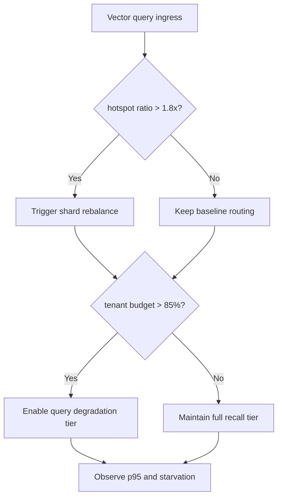
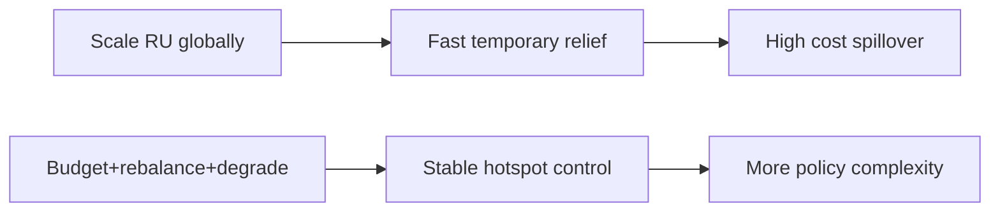
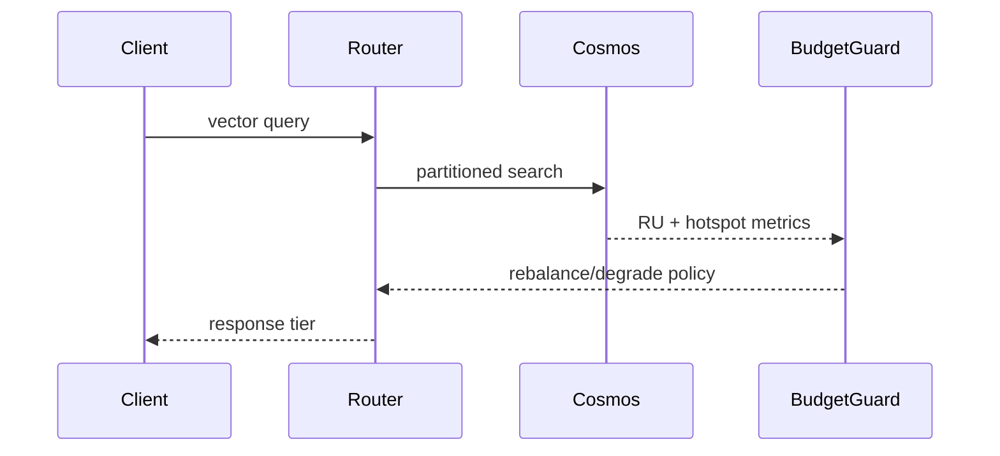

# Agent Cosmos DiskANN RU Hotspot Isolation Selection FAQ (Azure AI Agent Infra)

## 1) 3-minute conclusions
- **In multi-tenant Cosmos DiskANN retrieval, partition-key hotspots amplify RU jitter and p95 latency.**
- **Recommended: tenant RU budget pool + hotspot rebalance + query degradation thresholds.**
- **Targets: `ru_hotspot_ratio <1.8x`, `query_p95 <220ms`, `tenant_starvation=0`.**

## 2) Q1 / Q2 / Q3
- **Why hotspots worsen quickly?** Similarity-heavy queries converge on the same vector partitions.
- **Why not just raise RU globally?** Cost spills over and skew remains unresolved.
- **Minimum loop?** Hotspot detection, shard migration, tenant budget guardrails.

### Q1: When to rebalance?
When hotspot ratio stays above threshold and latency rises.

### Q2: When to degrade query tier?
When budget usage nears cap.

### Q3: How to quantify gains?
Compare tail latency, starved tenants, and RU spend.

## 3) Mermaid diagrams
### 3.1 Decision tree

### 3.2 Path comparison

### 3.3 Sequence

## 4) Decision matrix
| Dimension | Global RU scale-up | Budget+rebalance+degrade (Recommended) |
|---|---:|---:|
| Hotspot suppression | Medium | High |
| Cost control | Low | High |
| Ops complexity (1-10) | 4 | 8 |
| Multi-tenant fairness | Medium | High |
| Sustainable scaling | Medium | High |

## 5) Quant model + 7-card insights
- Hotspot ratio: `HotspotRatio = MaxPartitionRU / MedianPartitionRU`
- Gain: `LatencyGain = BaselineP95 - GuardedP95`
- Example (`synthetic_assumed`):
  - `MaxPartitionRU=3,780, MedianPartitionRU=2,300`
  - `HotspotRatio=1.64x`
  - `BaselineP95=318ms, GuardedP95=201ms`
  - `LatencyGain=117ms`
- Evidence:
  - `workshops/azure-agent-infra/evidence/cycle-1474-benchmark.json`
  - `workshops/azure-agent-infra/evidence/cycle-1474-sources.json`
- Labels: `official/synthetic_assumed/not_measured`.

## 6) Production verification checklist
- [ ] Hotspot metrics and rebalance thresholds are versioned
- [ ] Tenant budget pool and alerts are traceable
- [ ] Query degradation policy has replay validation
- [ ] Starvation protection rules are active
- [ ] FAQ/7-card source labels are complete
