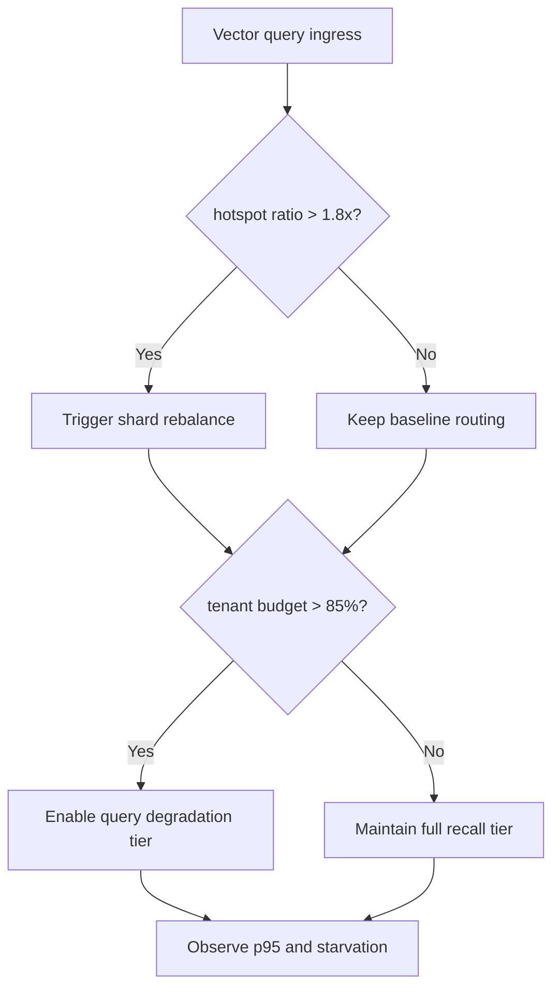
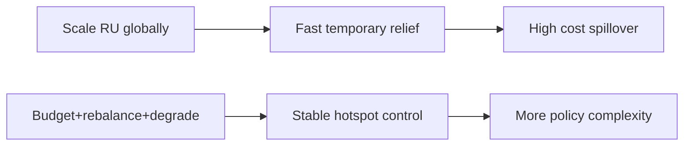
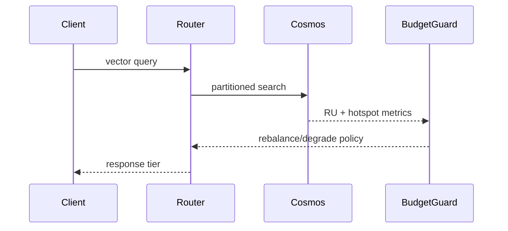

# Agent Cosmos DiskANN RU Hotspot Isolation 选型 FAQ（Azure AI Agent Infra）

## 1) 3 分钟结论
- **Cosmos DB DiskANN 多租户检索场景，分区键热点会放大 RU 抖动并拖慢 P95。**
- **推荐“租户 RU 预算池 + 热点分片重平衡 + 查询降级阈值”三段防护。**
- **目标阈值：`ru_hotspot_ratio <1.8x`、`query_p95 <220ms`、`tenant_starvation=0`。**

## 2) Q1 / Q2 / Q3
- **为何热点会恶化？**：高相似检索集中命中同分区向量段。
- **为何不能只提 RU？**：会带来整体成本外溢且不能根治倾斜。
- **最小闭环？**：热点识别、分片迁移、租户预算护栏。

### Q1：何时触发重平衡？
热点比率持续超阈值且延迟抬升。

### Q2：何时降级查询？
预算逼近上限时启用近似层级降级。

### Q3：收益如何衡量？
比较尾延迟、饥饿租户数和 RU 成本。

## 3) Mermaid 图
### 3.1 决策树

### 3.2 路径对比

### 3.3 时序

## 4) 决策矩阵
| 维度 | 全局提 RU | 预算+重平衡+降级（推荐） |
|---|---:|---:|
| 热点抑制 | 中 | 高 |
| 成本可控性 | 低 | 高 |
| 运维复杂度（1-10） | 4 | 8 |
| 多租户公平性 | 中 | 高 |
| 可持续扩展性 | 中 | 高 |

## 5) 定量算例与 7-Card 洞察
- 热点比率：`HotspotRatio = MaxPartitionRU / MedianPartitionRU`
- 收益：`LatencyGain = BaselineP95 - GuardedP95`
- 示例（`synthetic_assumed`）：
  - `MaxPartitionRU=3,780, MedianPartitionRU=2,300`
  - `HotspotRatio=1.64x`
  - `BaselineP95=318ms, GuardedP95=201ms`
  - `LatencyGain=117ms`
- 证据：
  - `workshops/azure-agent-infra/evidence/cycle-1474-benchmark.json`
  - `workshops/azure-agent-infra/evidence/cycle-1474-sources.json`
- 标签：`official/synthetic_assumed/not_measured`。

## 6) 生产核验 Checklist
- [ ] 热点检测指标与分片迁移阈值版本化
- [ ] 租户预算池与告警联动可追溯
- [ ] 查询降级策略有回放验证
- [ ] 饥饿租户保护规则生效
- [ ] FAQ/7-Card 来源标签完整
