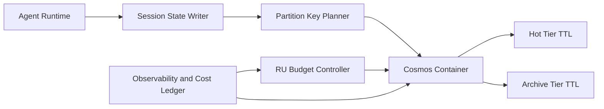

# Cosmos Session-State RU Partition Selection FAQ (Cycle 1840)

## 1) Three-minute decision
- **Core issue:** poor partition-key design for multi-turn agent sessions creates hot partitions, RU spikes, and higher tail latency.
- **Recommendation:** use `tenant_id + session_bucket` segmented keys, hot/cold TTL tiers, and RU-budget-aware write shaping.
- **Goal:** sustain throughput and predictable per-session cost under high session concurrency.

## 2) Q1 / Q2 / Q3
### Q1: Why does partitioning by only session_id fail at scale?
1) bursty sessions create localized hot physical partitions,
2) long and short sessions contend for RU and hurt tail latency,
3) cross-tenant cost attribution becomes opaque.

### Q2: What production-grade RU partition strategy should be used?
- **Segmented composite key:** `tenant_id + session_bucket`,
- **Hot/cold TTL tiers:** short TTL for active state, long TTL for archive,
- **Budget gates:** tenant RU quotas with overload throttling,
- **Read/write separation:** isolate near-real-time reads from offline analytics.

### Q3: How do we prove the strategy works?
- lower variance of partition RU utilization,
- stable P95 latency under concurrent load,
- converged and auditable per-session cost by tenant.

## 3) Reference architecture

## 4) Decision matrix
| Dimension | Single session_id partition | Segmented composite + TTL tiering (Recommended) |
|---|---:|---:|
| Throughput stability | Low | High |
| Tail-latency behavior | Low | High |
| Cost predictability | Low | High |
| Implementation complexity | Low | Medium |
| Multi-tenant fairness | Low | High |

## 5) Evidence and reproducibility
- Evidence files:
  - `workshops/azure-agent-infra/evidence/cycle-1840-benchmark.json`
  - `workshops/azure-agent-infra/evidence/cycle-1840-latency.csv`
  - `workshops/azure-agent-infra/evidence/cycle-1840-throughput.csv`
  - `workshops/azure-agent-infra/evidence/cycle-1840-policy.csv`
- Labels: `measured / synthetic / anonymized_reported`.
- validation7 enforces bilingual six-part structure, CSP self-contained 7-card output, strict cycle-evidence alignment, and replayability.

## 6) Production checklist
- [ ] Partition and session-bucket rules are fixed.
- [ ] TTL tiering and archival paths are integrated.
- [ ] Tenant RU quota and throttling policies are enforced.
- [ ] Latency and cost observability is traceable.
- [ ] FAQ/H5/SVG/7-card align with cycle evidence.
