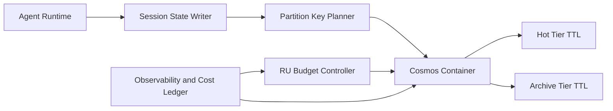

# Cosmos 会话状态 RU 分区选型 FAQ（Cycle 1840）

## 1) 3 分钟结论
- **核心问题：** Agent 多轮会话状态若分区键设计不当，会出现热点分区、RU 突刺和尾延迟上升。
- **推荐：** 采用 `tenant_id + session_bucket` 复合分段键、冷热分层 TTL、写入整形与重试预算联动。
- **目标：** 在高并发会话下保持稳定吞吐与可预测单会话成本。

## 2) Q1 / Q2 / Q3
### Q1：为什么只用 session_id 做分区键会出问题？
1) 会话写入高峰时热点会集中到少数物理分区；
2) 长会话与短会话混存导致 RU 争用，影响尾延迟；
3) 跨租户成本归因困难，容量规划不透明。

### Q2：生产级 RU 分区策略怎么做？
- **复合分段键：** `tenant_id + session_bucket` 分摊写入压力；
- **冷热分层 TTL：** 热状态短 TTL，归档状态长 TTL；
- **预算门禁：** 每租户 RU 配额 + 超额节流策略；
- **读写分离：** 近实时查询与离线分析拆路，降低互扰。

### Q3：如何验证分区方案有效？
- 分区 RU 利用率方差下降；
- P95 延迟在高并发下稳定；
- 单会话成本波动收敛并可按租户审计。

## 3) 架构图

## 4) 选型矩阵
| 维度 | 单 session_id 分区 | 复合分段 + TTL 分层（推荐） |
|---|---:|---:|
| 吞吐稳定性 | 低 | 高 |
| 尾延迟表现 | 低 | 高 |
| 成本可预测性 | 低 | 高 |
| 实施复杂度 | 低 | 中 |
| 多租户公平性 | 低 | 高 |

## 5) 证据与复算口径
- 证据文件：
  - `workshops/azure-agent-infra/evidence/cycle-1840-benchmark.json`
  - `workshops/azure-agent-infra/evidence/cycle-1840-latency.csv`
  - `workshops/azure-agent-infra/evidence/cycle-1840-throughput.csv`
  - `workshops/azure-agent-infra/evidence/cycle-1840-policy.csv`
- 标签：`measured / synthetic / anonymized_reported`。
- validation7：双语六段结构、7-card CSP 自包含、轮次与 evidence 一致、可回放链路通过。

## 6) 生产检查清单
- [ ] 分区键与 session_bucket 规则已固化。
- [ ] TTL 分层与归档策略已联调。
- [ ] RU 配额与节流策略已按租户生效。
- [ ] 延迟/成本观测面板可追溯。
- [ ] FAQ/H5/SVG/7-card 与 evidence 轮次一致。
