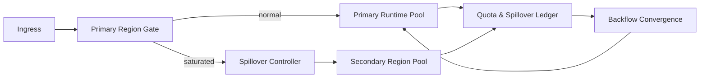

# Agent Cross-region Quota Spillover Selection FAQ (Cycle 1818)

## 1) Three-minute decision
- **Core tension:** when single-region utilization is high, local spikes cause sharp rejections; cross-region fallback can increase latency and cost.
- **Recommendation:** primary-first routing + quota-governed spillover + controlled backflow.
- **Goal:** improve availability under bounded cross-region budget and avoid persistent cross-region overuse.

## 2) Q1 / Q2 / Q3
### Q1: Why does strict local-first fail under stress?
1) regional peaks saturate local queues,
2) single-region fault scenarios have no elasticity path,
3) retry-only behavior inflates tail latency.

### Q2: What spillover strategy is production-ready?
- **Ingress gate:** permit spillover only after primary watermark breach,
- **Budget control:** tenant/minute spillover quotas,
- **Route fallback:** gradual backflow when primary recovers,
- **Consistency:** idempotency keys and version stamps for state writes.

### Q3: How do we prove availability gain with cost control?
- higher success rate during primary saturation,
- cross-region cost share stays within budget,
- controlled error/jitter during backflow windows.

## 3) Reference architecture

## 4) Decision matrix
| Dimension | Single-region hard cap | Cross-region quota spillover (Recommended) |
|---|---:|---:|
| Peak availability | Low | High |
| Cross-region cost control | High | Medium |
| Fault resilience | Low | High |
| Implementation complexity | Low | Medium |
| Operational observability | Medium | High |

## 5) Evidence and reproducibility
- Evidence files:
  - `workshops/azure-agent-infra/evidence/cycle-1818-benchmark.json`
  - `workshops/azure-agent-infra/evidence/cycle-1818-latency.csv`
  - `workshops/azure-agent-infra/evidence/cycle-1818-throughput.csv`
  - `workshops/azure-agent-infra/evidence/cycle-1818-policy.csv`
- Labels: `measured / synthetic / anonymized_reported`.
- validation7 enforces bilingual six-part structure, CSP self-contained 7-card output, cycle-evidence alignment, and replayability.

## 6) Production checklist
- [ ] Primary saturation threshold and spillover gates are fixed.
- [ ] Cross-region quota and cost budget policies are deployed.
- [ ] Backflow pacing and anti-oscillation controls are integrated.
- [ ] Idempotency/version consistency policy is validated.
- [ ] FAQ/H5/SVG/7-card align with cycle evidence.
