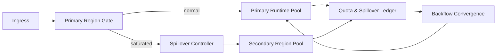

# Agent 跨区域配额溢出选型 FAQ（Cycle 1818）

## 1) 3 分钟结论
- **核心矛盾：** 单区域容量利用率高时，局部突发会迅速触发拒绝；跨区域兜底又可能放大成本与延迟。
- **推荐：** 主区域优先 + 跨区域配额溢出（spillover）+ 回流收敛三段策略。
- **目标：** 在受控跨区预算内提升可用性，避免长期“跨区常态化”导致 TCO 失控。

## 2) Q1 / Q2 / Q3
### Q1：为什么“全量本地优先”会失效？
1) 区域性峰值会使本地队列饱和；
2) 单区故障时无弹性回路；
3) 仅靠重试会把尾延迟拉高。

### Q2：可落地的跨区溢出策略是什么？
- **入口门禁**：仅当主区水位触顶才放行 spillover；
- **预算控制**：对跨区请求设置每租户/每分钟溢出额度；
- **路由回退**：主区恢复后逐步回流，防止来回抖动；
- **一致性约束**：状态写入采用幂等键与版本戳。

### Q3：如何验证“可用性提升且成本可控”？
- 主区饱和时成功率提升；
- 跨区成本占比维持在预算内；
- 回流阶段错误率和抖动可控。

## 3) 架构图

## 4) 选型矩阵
| 维度 | 单区域硬封顶 | 跨区配额溢出（推荐） |
|---|---:|---:|
| 峰值可用性 | 低 | 高 |
| 跨区成本可控性 | 高 | 中 |
| 故障韧性 | 低 | 高 |
| 实施复杂度 | 低 | 中 |
| 运营可观测性 | 中 | 高 |

## 5) 证据与复算口径
- 证据文件：
  - `workshops/azure-agent-infra/evidence/cycle-1818-benchmark.json`
  - `workshops/azure-agent-infra/evidence/cycle-1818-latency.csv`
  - `workshops/azure-agent-infra/evidence/cycle-1818-throughput.csv`
  - `workshops/azure-agent-infra/evidence/cycle-1818-policy.csv`
- 标签：`measured / synthetic / anonymized_reported`。
- validation7：双语六段结构、7-card CSP 自包含、轮次与 evidence 一致、可回放校验通过。

## 6) 生产检查清单
- [ ] 主区触顶阈值与 spillover 放行规则已固化。
- [ ] 跨区配额与成本预算阈值已落地。
- [ ] 回流节奏与防抖策略已联调。
- [ ] 幂等键/版本戳一致性策略已验证。
- [ ] FAQ/H5/SVG/7-card 与 evidence 轮次一致。
