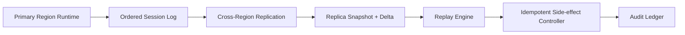

# Agent Cross-Region Session Replay Selection FAQ (Cycle 1795)

## 1) Three-minute decision
- **Cross-region HA fails not because replicas are missing, but because recovered replicas cannot replay session state deterministically.**
- **Recommendation:** ordered primary-region logs + replica incremental snapshots + versioned replay with idempotency checks.
- **Goal:** preserve conversational continuity during regional failover while preventing duplicate side effects.

## 2) Core questions (Q1/Q2/Q3)
### Q1: Why is async replication alone insufficient?
1) replication lag creates state gaps,
2) tool side effects can be re-triggered,
3) missing replay semantics makes outcomes hard to explain.

### Q2: What is a practical production model?
- primary writes ordered events with idempotency keys,
- replica keeps point-in-time snapshots plus deltas,
- recovery replays from snapshot under versioned rules,
- external side effects use replay allow-lists and idempotent confirmation.

### Q3: How to verify effectiveness?
- RTO/RPO targets are met,
- post-replay state consistency improves,
- duplicate side-effect rate stays bounded.

## 3) Reference architecture

## 4) Decision matrix
| Dimension | Async replication only | Snapshot + delta replay (Recommended) |
|---|---:|---:|
| Recovery determinism | Low | High |
| Side-effect control | Low | High |
| RTO/RPO behavior | Medium | High |
| Implementation complexity | Low | Medium |
| Audit explainability | Medium | High |

## 5) Evidence and reproducibility
- Evidence files:
  - `workshops/azure-agent-infra/evidence/cycle-1795-benchmark.json`
  - `workshops/azure-agent-infra/evidence/cycle-1795-latency.csv`
  - `workshops/azure-agent-infra/evidence/cycle-1795-throughput.csv`
  - `workshops/azure-agent-infra/evidence/cycle-1795-policy.csv`
- Labels: `measured / synthetic / anonymized_reported`.
- validation7 requires bilingual structure fidelity, CSP self-contained cards, cycle-consistent evidence, and replayability checks.

## 6) Production checklist
- [ ] Primary session log has global ordering and versioning.
- [ ] Replica snapshot/delta retention windows are defined.
- [ ] Replay allow-list covers side-effecting tool calls.
- [ ] Idempotency conflict and rollback paths are observable.
- [ ] FAQ/H5/SVG/7-card align with cycle evidence.
