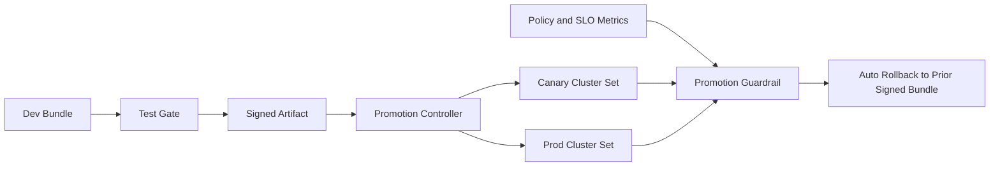

# Crossplane Policy-Bundle Promotion Selection FAQ (Cycle 1838)

## 1) Three-minute decision
- **Root issue:** promoting policy bundles from dev to prod without rollback gates can spread bad constraints across clusters.
- **Recommended pattern:** layered bundles, promotion guardrails, signed approvals, and automated rollback.
- **Expected gain:** increase policy delivery speed while preserving production safety boundaries with auditable controls.

## 2) Q1 / Q2 / Q3
### Q1: Why is direct production bundle overwrite risky?
1) faulty constraints fan out to many clusters instantly,
2) without signature and approval chains, ownership and provenance are unclear,
3) without promotion gates, regressions are discovered late and mitigation is slow.

### Q2: What is a production-ready Crossplane promotion model?
- **Layered repos:** split base and environment overlays,
- **Promotion gates:** dry-run simulation, admission checks, and business probes,
- **Signed approvals:** artifact signatures plus dual approval,
- **Auto rollback:** continuous post-promotion checks with rollback to prior signed version.

### Q3: How do we justify adopting this mechanism?
- higher promotion success rate,
- lower trigger and recovery latency,
- lower false-block rate with complete audit lineage.

## 3) Reference architecture

## 4) Decision matrix
| Dimension | Direct prod bundle push | Layered promotion with signed rollback (Recommended) |
|---|---:|---:|
| Delivery speed | High | Medium-high |
| Risk control | Low | High |
| Auditability | Low | High |
| Multi-cluster consistency | Medium | High |
| Ops complexity | Low | Medium |

## 5) Evidence and reproducibility
- Evidence files:
  - `workshops/azure-agent-infra/evidence/cycle-1838-benchmark.json`
  - `workshops/azure-agent-infra/evidence/cycle-1838-latency.csv`
  - `workshops/azure-agent-infra/evidence/cycle-1838-throughput.csv`
  - `workshops/azure-agent-infra/evidence/cycle-1838-policy.csv`
- Labels: `measured / synthetic / anonymized_reported`.
- validation7 enforces bilingual six-part structure, CSP self-contained 7-card output, strict cycle-evidence alignment, and replayability.

## 6) Production checklist
- [ ] Base/overlay layering is in place.
- [ ] Dry-run and admission checks are wired into promotion gates.
- [ ] Signature and dual-approval policy is active.
- [ ] Auto-rollback trigger and recovery path are validated.
- [ ] FAQ/H5/SVG/7-card align with cycle evidence.
