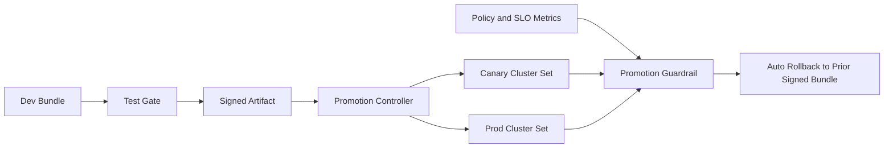

# Crossplane 策略包晋级选型 FAQ（Cycle 1838）

## 1) 3 分钟结论
- **问题本质：** 平台策略包从 dev 到 prod 晋级时，若缺少可回滚关口，会把错误策略传播到多集群。
- **推荐路径：** 分层策略包 + 环境晋级门禁 + 审批签名 + 自动回退。
- **核心收益：** 用可审计的晋级流水线把“策略变更速度”和“生产安全边界”同时拉高。

## 2) Q1 / Q2 / Q3
### Q1：为什么“直接覆盖生产策略包”风险高？
1) 多集群会同时接收错误约束，故障面瞬时放大；
2) 无签名与审批链，难以确认责任与版本来源；
3) 缺少门禁指标时，策略回归依赖人工发现，止损慢。

### Q2：Crossplane 策略包晋级的生产做法是什么？
- **分层仓库：** base / env overlay 分离，避免环境耦合；
- **晋级门禁：** dry-run 演算 + 准入测试 + 业务探针；
- **签名审批：** 变更签名与双人审批绑定；
- **自动回退：** 晋级后持续观测，触发阈值自动回滚到上一个签名版本。

### Q3：如何评估是否值得上这套机制？
- 平均晋级成功率提高；
- 回退触发与恢复时延降低；
- 误拦截率下降，且审计追踪链完整。

## 3) 架构图

## 4) 选型矩阵
| 维度 | 直推生产策略包 | 分层晋级与签名回退（推荐） |
|---|---:|---:|
| 交付速度 | 高 | 中高 |
| 风险可控性 | 低 | 高 |
| 审计追踪 | 低 | 高 |
| 多集群一致性 | 中 | 高 |
| 运维复杂度 | 低 | 中 |

## 5) 证据与复算口径
- 证据文件：
  - `workshops/azure-agent-infra/evidence/cycle-1838-benchmark.json`
  - `workshops/azure-agent-infra/evidence/cycle-1838-latency.csv`
  - `workshops/azure-agent-infra/evidence/cycle-1838-throughput.csv`
  - `workshops/azure-agent-infra/evidence/cycle-1838-policy.csv`
- 标签：`measured / synthetic / anonymized_reported`。
- validation7：双语六段结构、7-card CSP 自包含、轮次与 evidence 一致、可回放链路通过。

## 6) 生产检查清单
- [ ] base/overlay 策略包分层完成。
- [ ] dry-run 与准入测试已接入晋级门禁。
- [ ] 签名与双人审批策略生效。
- [ ] 自动回退触发与恢复链路演练通过。
- [ ] FAQ/H5/SVG/7-card 与 evidence 轮次一致。
