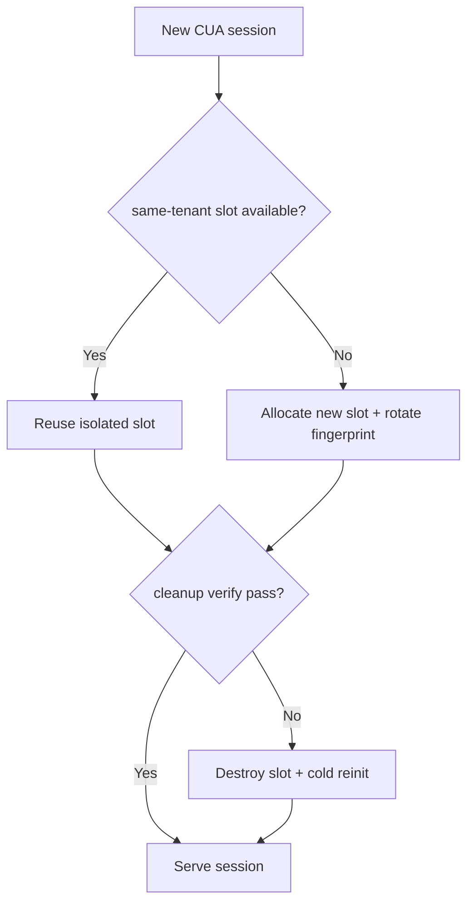
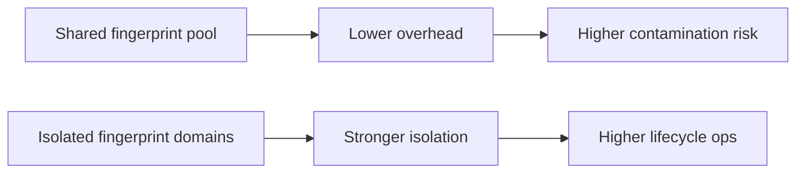
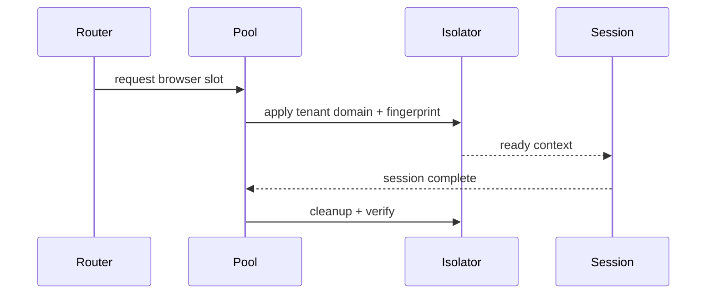

# Agent CUA Browser Pool Fingerprint Isolation Selection FAQ (Azure AI Agent Infra)

## 1) 3-minute conclusions
- **Without fingerprint isolation, CUA browser pools can leak behavior across tenants and trigger risk misclassification.**
- **Use isolated domains + fingerprint rotation + post-session cleanup verification.**
- **Targets: `cross_tenant_trace=0`, `fingerprint_reuse <0.2%`, `cleanup_p95 <1.1s`.**

## 2) Q1 / Q2 / Q3
- **Why contamination happens?** Residual context traits can be inherited by later sessions.
- **Why not always cold-start new instances?** Cost and startup latency are too high.
- **Minimum loop?** Domain assignment, fingerprint rotation, cleanup verification.

### Q1: When to force rotation?
On tenant switch or elevated risk score.

### Q2: When to destroy a slot?
When cleanup fails or reuse exceeds thresholds.

### Q3: How to quantify gain?
Compare isolation strength and performance overhead.

## 3) Mermaid diagrams
### 3.1 Decision tree

### 3.2 Path comparison

### 3.3 Sequence

## 4) Decision matrix
| Dimension | Shared fingerprint pool | Isolated domain + rotation (Recommended) |
|---|---:|---:|
| Isolation strength | Medium-low | High |
| Performance | High | Medium-high |
| Ops complexity (1-10) | 4 | 8 |
| Compliance | Medium | High |
| Risk controllability | Medium-low | High |

## 5) Quant model + 7-card insights
- Reuse rate: `ReuseRate = ReusedFingerprint / TotalSessions`
- Isolation gain: `IsolationGain = BaselineLeak - GuardedLeak`
- Example (`synthetic_assumed`):
  - `ReusedFingerprint=14, TotalSessions=9,800`
  - `ReuseRate=0.14%`
  - `BaselineLeak=0.9%, GuardedLeak=0.0%`
  - `IsolationGain=0.9%`
- Evidence:
  - `workshops/azure-agent-infra/evidence/cycle-1488-benchmark.json`
  - `workshops/azure-agent-infra/evidence/cycle-1488-sources.json`
- Labels: `official/synthetic_assumed/not_measured`.

## 6) Production verification checklist
- [ ] Domain mapping and rotation policy are auditable
- [ ] Cleanup-failure auto-destroy path works
- [ ] Reuse/leak metrics are continuously monitored
- [ ] High-risk tenants enforce cold-start strategy
- [ ] FAQ/7-card source labels are complete
