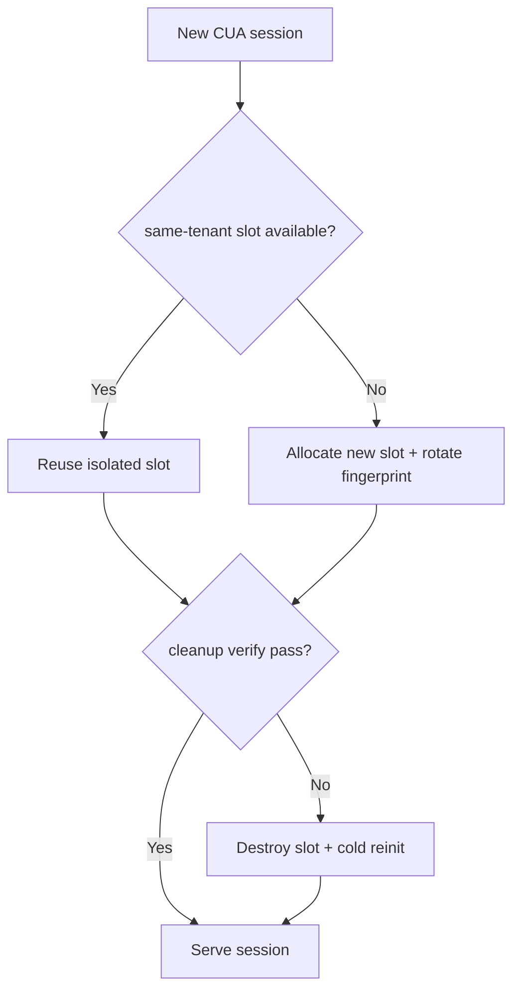
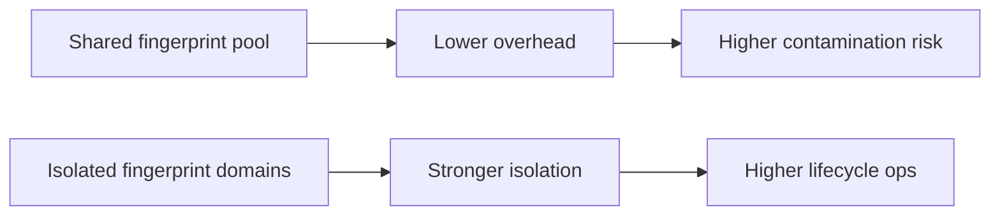
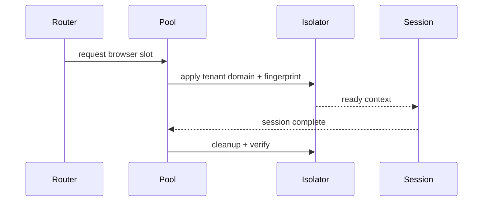

# Agent CUA Browser Pool Fingerprint Isolation 选型 FAQ（Azure AI Agent Infra）

## 1) 3 分钟结论
- **CUA 浏览器池若指纹隔离不足，会导致跨租户行为污染与风控误判。**
- **推荐“池内隔离域 + 指纹轮换 + 会话后清洗”三重控制。**
- **目标阈值：`cross_tenant_trace=0`、`fingerprint_reuse <0.2%`、`cleanup_p95 <1.1s`。**

## 2) Q1 / Q2 / Q3
- **为何会污染？**：同池上下文残留特征可被后续会话继承。
- **为何不能每次全新实例？**：成本与启动延迟过高。
- **最小闭环？**：隔离域分配、指纹轮换、收尾清洗校验。

### Q1：何时强制轮换指纹？
租户切换或风险分值升高时。

### Q2：何时销毁池实例？
清洗失败或复用率超阈值。

### Q3：如何衡量收益？
比较安全隔离强度与性能开销。

## 3) Mermaid 图
### 3.1 决策树

### 3.2 路径对比

### 3.3 时序

## 4) 决策矩阵
| 维度 | 共享指纹池 | 隔离域+轮换（推荐） |
|---|---:|---:|
| 隔离强度 | 中低 | 高 |
| 性能 | 高 | 中高 |
| 运维复杂度（1-10） | 4 | 8 |
| 合规性 | 中 | 高 |
| 风险可控性 | 中低 | 高 |

## 5) 定量算例与 7-Card 洞察
- 复用率：`ReuseRate = ReusedFingerprint / TotalSessions`
- 隔离收益：`IsolationGain = BaselineLeak - GuardedLeak`
- 示例（`synthetic_assumed`）：
  - `ReusedFingerprint=14, TotalSessions=9,800`
  - `ReuseRate=0.14%`
  - `BaselineLeak=0.9%, GuardedLeak=0.0%`
  - `IsolationGain=0.9%`
- 证据：
  - `workshops/azure-agent-infra/evidence/cycle-1488-benchmark.json`
  - `workshops/azure-agent-infra/evidence/cycle-1488-sources.json`
- 标签：`official/synthetic_assumed/not_measured`。

## 6) 生产核验 Checklist
- [ ] 隔离域映射与轮换策略可审计
- [ ] 清洗校验失败自动销毁链路可用
- [ ] 复用率与泄漏指标持续监控
- [ ] 高风险租户强制冷启策略生效
- [ ] FAQ/7-Card 来源标签完整
