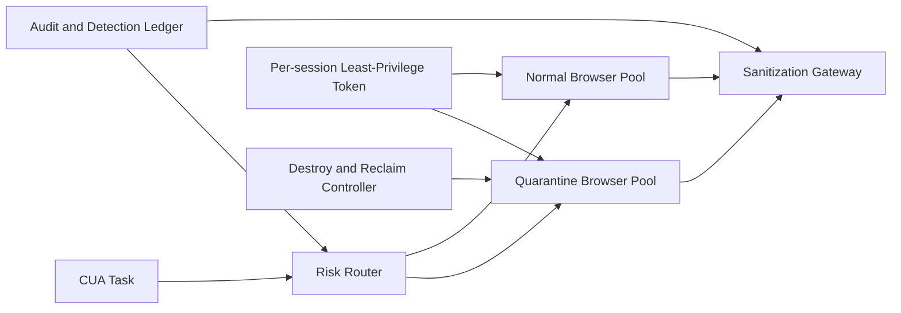

# CUA Browser Quarantine-Domain Selection FAQ (Cycle 1857)

## 1) Three-minute decision
- **Core tradeoff:** browser automation needs real web access, but unrestricted access expands download/script/session-hijack risk.
- **Recommendation:** quarantine-domain pools, bidirectional content sanitization, and per-session least-privilege tokens.
- **Goal:** keep automation usable while confining high-risk web interactions to auditable, reclaimable boundaries.

## 2) Q1 / Q2 / Q3
### Q1: Why is shared-browser direct internet access risky?
1) cross-task cookie/localStorage residue leaks data,
2) download and clipboard channels can spread malicious payloads,
3) compromise blast radius is larger due to short lateral paths.

### Q2: What production-grade browser quarantine design should be used?
- **Quarantine pools:** high-risk targets execute in isolated pools,
- **Content sanitization:** downloaded files and form-copy channels pass security scanning,
- **Least-privilege sessions:** task-scoped short-lived tokens and domain allowlists,
- **Expiry destruction:** force-destroy browser profiles and temp volumes at session end.

### Q3: How do we validate security without efficiency loss?
- higher interception accuracy on risky tasks,
- automation success rate stays within targets,
- controlled recovery and rebuild latency.

## 3) Reference architecture

## 4) Decision matrix
| Dimension | Shared pool direct access | Tiered quarantine domains (Recommended) |
|---|---:|---:|
| Security isolation | Low | High |
| Automation success rate | Medium | Medium-high |
| Auditability | Low | High |
| Implementation complexity | Low | Medium |
| Recovery controllability | Low | High |

## 5) Evidence and reproducibility
- Evidence files:
  - `workshops/azure-agent-infra/evidence/cycle-1857-benchmark.json`
  - `workshops/azure-agent-infra/evidence/cycle-1857-latency.csv`
  - `workshops/azure-agent-infra/evidence/cycle-1857-throughput.csv`
  - `workshops/azure-agent-infra/evidence/cycle-1857-policy.csv`
- Labels: `measured / synthetic / anonymized_reported`.
- validation7 enforces bilingual six-part structure, CSP self-contained 7-card output, strict cycle-evidence alignment, and replayability.

## 6) Production checklist
- [ ] Risk routing and quarantine-pool policy are active.
- [ ] Download/input sanitization paths are integrated.
- [ ] Session least-privilege tokens and allowlists are enforced.
- [ ] Expiry destruction and reclaim drills pass.
- [ ] FAQ/H5/SVG/7-card align with cycle evidence.
