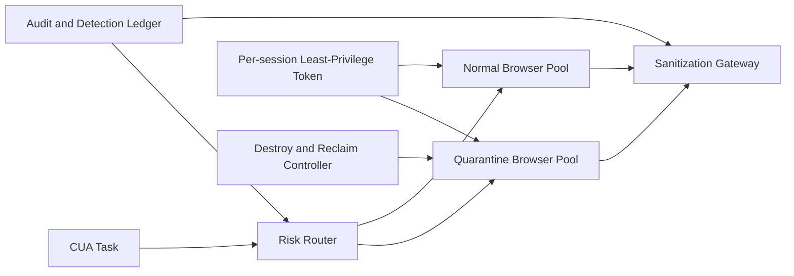

# CUA Browser 隔离检疫域选型 FAQ（Cycle 1857）

## 1) 3 分钟结论
- **核心矛盾：** 浏览器自动化链路需要真实外网交互，但直接放行会扩大下载、脚本注入与会话劫持风险。
- **推荐：** 检疫域运行池 + 双向内容消毒 + 会话级最小权限令牌。
- **目标：** 在不牺牲自动化可用性的前提下，将高风险网页交互限制在可审计、可回收边界内。

## 2) Q1 / Q2 / Q3
### Q1：为什么“共享浏览器池直连公网”风险高？
1) 跨任务残留 cookie/localStorage 会造成数据泄露；
2) 下载文件与剪贴板通道易形成恶意载荷传播；
3) 单点被攻破后横向移动路径过短。

### Q2：生产级 Browser 检疫域如何设计？
- **检疫域池：** 高风险站点仅在隔离池执行，低风险站点走标准池；
- **内容消毒：** 下载文件、表单回填、复制内容通过安全网关扫描；
- **会话最小权限：** 每任务独立短期令牌与域名 allowlist；
- **到期销毁：** 会话结束强制销毁浏览器配置与临时卷。

### Q3：如何验证“安全且不降效”？
- 高风险任务拦截准确率提升；
- 自动化成功率维持目标区间；
- 会话恢复与重建时延可控。

## 3) 架构图

## 4) 选型矩阵
| 维度 | 共享池直连 | 检疫域分层（推荐） |
|---|---:|---:|
| 安全隔离 | 低 | 高 |
| 自动化成功率 | 中 | 中高 |
| 可审计性 | 低 | 高 |
| 实施复杂度 | 低 | 中 |
| 恢复可控性 | 低 | 高 |

## 5) 证据与复算口径
- 证据文件：
  - `workshops/azure-agent-infra/evidence/cycle-1857-benchmark.json`
  - `workshops/azure-agent-infra/evidence/cycle-1857-latency.csv`
  - `workshops/azure-agent-infra/evidence/cycle-1857-throughput.csv`
  - `workshops/azure-agent-infra/evidence/cycle-1857-policy.csv`
- 标签：`measured / synthetic / anonymized_reported`。
- validation7：双语六段结构、7-card CSP 自包含、轮次与 evidence 一致、可回放链路通过。

## 6) 生产检查清单
- [ ] 风险路由规则与检疫池策略已启用。
- [ ] 下载/输入通道消毒链路联调通过。
- [ ] 会话最小权限令牌与 allowlist 生效。
- [ ] 到期销毁与资源回收演练通过。
- [ ] FAQ/H5/SVG/7-card 与 evidence 轮次一致。
