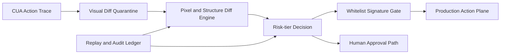

# CUA Visual Diff Quarantine Selection FAQ (Cycle 1870)

## 1) Three-minute decision
- **Core risk:** automated CUA actions can drift when UI structure changes unexpectedly.
- **Recommendation:** visual diff quarantine, action-signature allowlists, and tiered promotion.
- **Goal:** preserve automation speed while constraining misoperation risk inside controlled boundaries.

## 2) Q1 / Q2 / Q3
### Q1: Why are selector-only controls insufficient?
1) small UI changes can distort locator meaning,
2) dynamic layout and delayed rendering can trigger wrong actions,
3) scenario variance causes semantic drift for the same selector.

### Q2: How should production visual diff quarantine be designed?
- **Quarantine replay:** replay action traces in isolated environments first,
- **Diff detection:** combine pixel and structure thresholds for risk tiers,
- **Signature allowlists:** critical actions require approved signatures,
- **Tiered release:** auto-release low risk, human approval for medium/high risk.

### Q3: What is the go-live bar?
- stable replay pass rates in quarantine,
- material reduction in misoperation rate,
- post-release success/latency within target bands.

## 3) Reference architecture

## 4) Decision matrix
| Dimension | Selector-only automation | Visual Diff Quarantine (Recommended) |
|---|---:|---:|
| Misoperation suppression | Low | High |
| Change adaptability | Low | High |
| Automation efficiency | High | Medium-high |
| Implementation complexity | Low | Medium |
| Audit traceability | Medium | High |

## 5) Evidence and reproducibility
- Evidence files:
  - `workshops/azure-agent-infra/evidence/cycle-1870-benchmark.json`
  - `workshops/azure-agent-infra/evidence/cycle-1870-latency.csv`
  - `workshops/azure-agent-infra/evidence/cycle-1870-throughput.csv`
  - `workshops/azure-agent-infra/evidence/cycle-1870-policy.csv`
- Labels: `measured / synthetic / anonymized_reported`.
- validation7 enforces six-part structure, CSP-safe 7-card output, strict cycle-topic alignment, and replayable checks.

## 6) Production checklist
- [ ] Diff thresholds are calibrated with representative replay sets.
- [ ] Signature allowlists cover high-risk actions.
- [ ] Human-approval path and receipts are integrated.
- [ ] Release policy is stable under canary traffic.
- [ ] FAQ/H5/SVG/7-card/evidence remain cycle-consistent.
