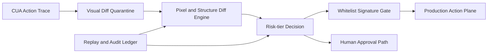

# CUA Visual Diff Quarantine 选型 FAQ（Cycle 1870）

## 1) 3 分钟结论
- **核心风险：** CUA 自动操作在 UI 变化时可能产生不可预期动作漂移。
- **推荐方案：** “视觉差异隔离区 + 操作签名白名单 + 逐级放行”机制。
- **目标：** 在保证自动化效率的同时把误操作风险收敛在隔离边界。

## 2) Q1 / Q2 / Q3
### Q1：为什么仅依赖元素选择器不够？
1) UI 细节改动常导致定位失真；
2) 动态布局与延迟渲染会引发误触发；
3) 场景差异导致同选择器语义漂移。

### Q2：生产级 visual diff quarantine 如何落地？
- **隔离回放：** 新页面版本先在隔离环境回放操作序列；
- **视觉差异判定：** 像素与结构双阈值触发风险分级；
- **签名白名单：** 关键操作需匹配允许签名；
- **逐级放行：** 低风险自动放行，中高风险人工确认。

### Q3：上线判据是什么？
- 隔离回放通过率稳定；
- 误操作率显著下降；
- 放行后任务成功率与时延保持在目标区间。

## 3) 架构图

## 4) 选型矩阵
| 维度 | 仅选择器自动执行 | Visual Diff Quarantine（推荐） |
|---|---:|---:|
| 误操作抑制 | 低 | 高 |
| 变更适应性 | 低 | 高 |
| 自动化效率 | 高 | 中高 |
| 实施复杂度 | 低 | 中 |
| 审计可追溯性 | 中 | 高 |

## 5) 证据与复算口径
- 证据文件：
  - `workshops/azure-agent-infra/evidence/cycle-1870-benchmark.json`
  - `workshops/azure-agent-infra/evidence/cycle-1870-latency.csv`
  - `workshops/azure-agent-infra/evidence/cycle-1870-throughput.csv`
  - `workshops/azure-agent-infra/evidence/cycle-1870-policy.csv`
- 标签：`measured / synthetic / anonymized_reported`。
- validation7：六段结构、7-card CSP、cycle-topic 对齐、验证链可回放。

## 6) 生产检查清单
- [ ] 视觉差异阈值通过典型场景回放校准。
- [ ] 签名白名单覆盖高风险操作。
- [ ] 人工审批路径与回执机制联调通过。
- [ ] 放行策略在灰度流量下稳定。
- [ ] FAQ/H5/SVG/7-card/evidence 轮次一致。
