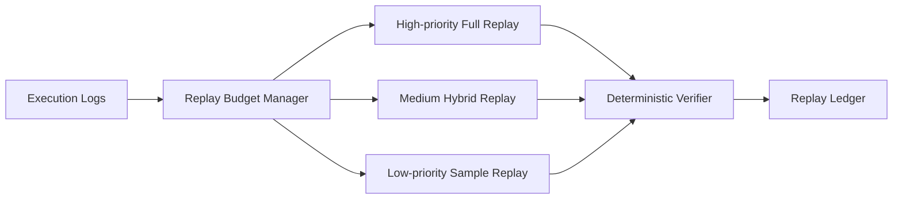

# Agent Deterministic Replay Budget Selection FAQ (Cycle 1811)

## 1) Three-minute decision
- **Replay non-reproducibility is usually caused not by missing logs, but by uncontrolled replay budgets and replay granularity.**
- **Recommendation:** tiered replay budgets + full replay for critical paths + sampled replay for non-critical paths.
- **Goal:** preserve deterministic reproduction for high-value incidents within bounded cost.

## 2) Q1 / Q2 / Q3
### Q1: Why is "replay everything" unsustainable?
1) compute/storage cost grows rapidly,
2) replay queues can starve online resources,
3) low-value replays dilute critical investigations.

### Q2: What budgeted replay strategy is practical?
- allocate replay budget by incident and tenant priority,
- keep full context/tool traces for critical paths,
- use summary+sampled replay for lower-priority paths,
- queue or degrade when replay budget is exhausted.

### Q3: How to validate effectiveness?
- higher first-pass reproduction rate,
- bounded replay wait time and cost,
- no significant online performance regression.

## 3) Reference architecture

## 4) Decision matrix
| Dimension | Uniform full replay | Budgeted deterministic replay (Recommended) |
|---|---:|---:|
| Reproducibility reliability | Medium | High |
| Cost controllability | Low | High |
| Online impact | High | Low |
| Implementation complexity | Low | Medium |
| Investigation efficiency | Medium | High |

## 5) Evidence and reproducibility
- Evidence files:
  - `workshops/azure-agent-infra/evidence/cycle-1811-benchmark.json`
  - `workshops/azure-agent-infra/evidence/cycle-1811-latency.csv`
  - `workshops/azure-agent-infra/evidence/cycle-1811-throughput.csv`
  - `workshops/azure-agent-infra/evidence/cycle-1811-policy.csv`
- Labels: `measured / synthetic / anonymized_reported`.
- validation7 requires bilingual structure fidelity, CSP self-contained cards, cycle-consistent evidence, and replayability checks.

## 6) Production checklist
- [ ] Replay budgets are tiered by incident and tenant priority.
- [ ] Critical-path full replay fields are complete.
- [ ] Sample replay ratio and queue policy are tunable.
- [ ] Replay jobs are resource-isolated from online paths.
- [ ] FAQ/H5/SVG/7-card align with cycle evidence.
