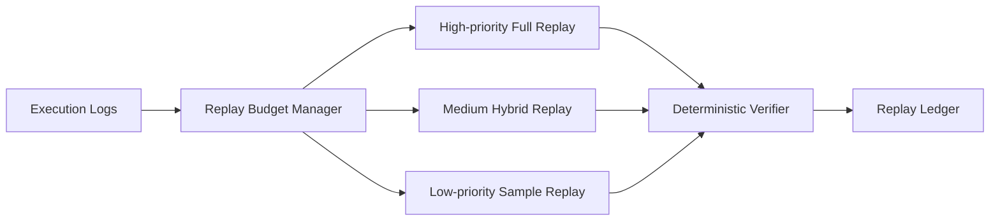

# Agent 确定性回放预算选型 FAQ（Cycle 1811）

## 1) 3 分钟结论
- **回放不可复现问题通常不是日志缺失，而是回放预算与重放粒度不受控。**
- **推荐：** 场景分级回放预算 + 关键路径全量重放 + 非关键路径抽样重放。
- **目标：** 在可控成本内保持高价值问题可确定复现。

## 2) Q1 / Q2 / Q3
### Q1：为什么“全量回放所有请求”不可持续？
1) 计算与存储成本迅速膨胀；
2) 回放队列压垮在线资源；
3) 低价值回放掩盖关键故障分析。

### Q2：可落地预算化回放策略？
- 按故障等级与租户等级分配回放预算；
- 关键链路保留完整上下文和工具调用轨迹；
- 低优链路使用摘要+采样回放；
- 预算耗尽时自动排队延迟或降级。

### Q3：如何验证策略有效？
- 关键问题一次复现率提升；
- 回放等待时间与成本受控；
- 在线性能不因回放任务显著下降。

## 3) 架构图

## 4) 选型矩阵
| 维度 | 全量统一回放 | 预算化确定性回放（推荐） |
|---|---:|---:|
| 复现可靠性 | 中 | 高 |
| 成本可控性 | 低 | 高 |
| 在线影响 | 高 | 低 |
| 实施复杂度 | 低 | 中 |
| 调查效率 | 中 | 高 |

## 5) 证据与复算口径
- 证据文件：
  - `workshops/azure-agent-infra/evidence/cycle-1811-benchmark.json`
  - `workshops/azure-agent-infra/evidence/cycle-1811-latency.csv`
  - `workshops/azure-agent-infra/evidence/cycle-1811-throughput.csv`
  - `workshops/azure-agent-infra/evidence/cycle-1811-policy.csv`
- 标签：`measured / synthetic / anonymized_reported`。
- validation7：双语结构、CSP 自包含、证据轮次一致、可回放链路校验通过。

## 6) 生产检查清单
- [ ] 回放预算按故障等级和租户等级配置。
- [ ] 关键链路全量回放字段完整。
- [ ] 采样回放比例与排队策略可调。
- [ ] 回放作业对在线资源有隔离限额。
- [ ] FAQ/H5/SVG/7-card 与 evidence 轮次一致。
