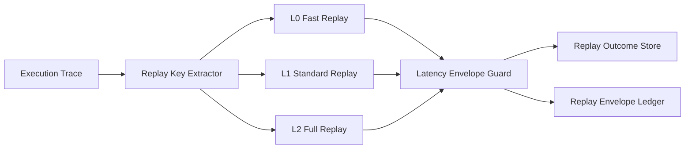

# Agent Deterministic Replay Latency Envelope Selection FAQ (Cycle 1830)

## 1) Three-minute decision
- **Core tension:** stronger determinism usually costs more latency, while lighter replay lowers latency but weakens reproducibility.
- **Recommendation:** tiered deterministic replay plus latency envelopes plus critical-path-priority replay.
- **Goal:** deliver reliable incident replay and auditing within explicit latency budgets.

## 2) Q1 / Q2 / Q3
### Q1: Why is full deterministic replay unsustainable?
1) full-state replay is expensive at scale,
2) replay waits can block online hot paths,
3) multi-tenant replay contention inflates tail latency.

### Q2: What production-ready envelope strategy should be used?
- **L0 fast replay:** critical events and key states only (seconds),
- **L1 standard replay:** dependency-complete context replay (minutes),
- **L2 full replay:** deep audit and postmortem replay (offline),
- **Envelope governance:** per-task P50 and P95 replay latency targets with timeout fallback.

### Q3: How do we validate reproducibility with bounded latency?
- P95 replay latency stays within envelope,
- replay success remains high for critical scenarios,
- online path jitter from replay contention is reduced.

## 3) Reference architecture

## 4) Decision matrix
| Dimension | Unified full replay | Tiered envelope replay (Recommended) |
|---|---:|---:|
| Replay latency controllability | Low | High |
| Critical scenario reproducibility | High | High |
| Online-path interference | High | Low |
| Implementation complexity | Low | Medium |
| Audit scalability | Medium | High |

## 5) Evidence and reproducibility
- Evidence files:
  - `workshops/azure-agent-infra/evidence/cycle-1830-benchmark.json`
  - `workshops/azure-agent-infra/evidence/cycle-1830-latency.csv`
  - `workshops/azure-agent-infra/evidence/cycle-1830-throughput.csv`
  - `workshops/azure-agent-infra/evidence/cycle-1830-policy.csv`
- Labels: `measured / synthetic / anonymized_reported`.
- validation7 enforces bilingual six-part structure, CSP self-contained 7-card output, strict cycle-evidence alignment, and replayability.

## 6) Production checklist
- [ ] Replay tiers (L0/L1/L2) and triggers are configured.
- [ ] Per-tier latency envelopes and timeout fallbacks are integrated.
- [ ] Critical-path replay resource isolation is validated.
- [ ] Replay ledger and alert chain are traceable.
- [ ] FAQ/H5/SVG/7-card align with cycle evidence.
