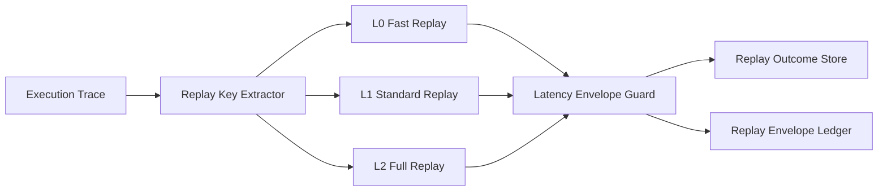

# Agent 确定性回放延迟包络选型 FAQ（Cycle 1830）

## 1) 3 分钟结论
- **核心矛盾：** 回放越确定，通常越重；回放越轻，延迟越低但复现实效下降。
- **推荐：** 分层确定性回放 + 延迟包络目标 + 关键路径优先重放。
- **目标：** 在既定时延预算内，确保故障复现与审计追踪可稳定落地。

## 2) Q1 / Q2 / Q3
### Q1：为什么“全量确定性回放”不可持续？
1) 全量状态重放吞吐成本高；
2) 热路径回放等待会阻塞在线请求；
3) 多租户场景下回放争抢资源，导致尾延迟抬升。

### Q2：可落地的延迟包络策略是什么？
- **L0 快速回放**：仅关键事件与关键状态，秒级反馈；
- **L1 标准回放**：补齐上下文依赖，分钟级验证；
- **L2 完整回放**：用于深度审计和复盘，离线执行；
- **包络治理**：为不同任务设最大回放时延（P50/P95）与超时降级路径。

### Q3：如何验证“可复现且可控延迟”？
- P95 回放时延不越界；
- 回放成功率在关键场景维持高位；
- 在线路径受回放影响的抖动显著下降。

## 3) 架构图

## 4) 选型矩阵
| 维度 | 全量统一回放 | 分层包络回放（推荐） |
|---|---:|---:|
| 回放时延可控性 | 低 | 高 |
| 关键场景复现率 | 高 | 高 |
| 在线链路干扰 | 高 | 低 |
| 实施复杂度 | 低 | 中 |
| 审计可扩展性 | 中 | 高 |

## 5) 证据与复算口径
- 证据文件：
  - `workshops/azure-agent-infra/evidence/cycle-1830-benchmark.json`
  - `workshops/azure-agent-infra/evidence/cycle-1830-latency.csv`
  - `workshops/azure-agent-infra/evidence/cycle-1830-throughput.csv`
  - `workshops/azure-agent-infra/evidence/cycle-1830-policy.csv`
- 标签：`measured / synthetic / anonymized_reported`。
- validation7：双语六段结构、7-card CSP 自包含、轮次与 evidence 一致、可回放链路通过。

## 6) 生产检查清单
- [ ] 回放分层（L0/L1/L2）与触发规则已配置。
- [ ] 各层延迟包络阈值与超时降级策略已联调。
- [ ] 关键路径回放资源隔离已验证。
- [ ] 回放账本与告警链路可追溯。
- [ ] FAQ/H5/SVG/7-card 与 evidence 轮次一致。
