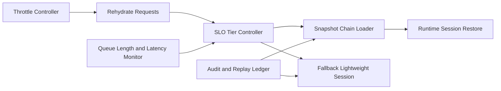

# Dynamic Session Rehydrate SLO Selection FAQ (Cycle 1877)

## 1) Three-minute decision
- **Core issue:** without tiered SLOs, session rehydrate paths can collapse under peak recovery and create timeout waves.
- **Recommendation:** combine tiered rehydrate SLOs, prewarmed snapshot chains, and fallback recovery modes.
- **Goal:** keep recovery latency and success stable during high-concurrency restore windows.

## 2) Q1 / Q2 / Q3
### Q1: Why is average rehydrate latency misleading?
1) means hide P95/P99 degradation,
2) session classes require different recovery targets,
3) peak queue congestion amplifies tail failures.

### Q2: What should production rehydrate SLO design include?
- **Tiered objectives:** class-based P50/P95/P99 recovery targets,
- **Snapshot chain:** incremental snapshots with stable restore anchors,
- **Failure fallback:** switch to lightweight session mode on restore failure,
- **Elastic throttling:** dynamically throttle by queue depth and latency.

### Q3: What is the go-live bar?
- class-level recovery SLOs are met,
- peak-time restore failure rate remains bounded,
- fallback mode preserves core continuity.

## 3) Reference architecture

## 4) Decision matrix
| Dimension | Single recovery target | Tiered SLO recovery (Recommended) |
|---|---:|---:|
| Tail-latency control | Low | High |
| Peak recovery stability | Low | High |
| Business continuity | Medium | High |
| Implementation complexity | Low | Medium |
| Observability | Medium | High |

## 5) Evidence and reproducibility
- Evidence files:
  - `workshops/azure-agent-infra/evidence/cycle-1877-benchmark.json`
  - `workshops/azure-agent-infra/evidence/cycle-1877-latency.csv`
  - `workshops/azure-agent-infra/evidence/cycle-1877-throughput.csv`
  - `workshops/azure-agent-infra/evidence/cycle-1877-policy.csv`
- Labels: `measured / synthetic / anonymized_reported`.
- validation7 enforces six-part structure, CSP-safe 7-card output, strict cycle-topic alignment, and replayable checks.

## 6) Production checklist
- [ ] Tiered rehydrate SLO thresholds are defined.
- [ ] Snapshot-chain restore path passes load tests.
- [ ] Lightweight fallback mode is available.
- [ ] Elastic throttle parameters adapt to queue depth.
- [ ] FAQ/H5/SVG/7-card/evidence remain cycle-consistent.
