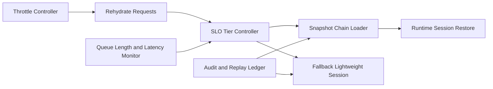

# Dynamic Session Rehydrate SLO 选型 FAQ（Cycle 1877）

## 1) 3 分钟结论
- **核心问题：** 会话重建（rehydrate）路径若缺少 SLO 分层，会在峰值恢复期出现大面积超时与体验断崖。
- **推荐方案：** “重建分级 SLO + 预热快照链 + 失败回退兜底”三位一体治理。
- **目标：** 在高并发恢复场景下稳定重建时延与成功率，防止恢复风暴。

## 2) Q1 / Q2 / Q3
### Q1：为什么只看平均重建时延会误判？
1) 平均值掩盖 P95/P99 恶化；
2) 不同会话等级恢复目标不同；
3) 峰值时队列拥塞会放大尾部失败。

### Q2：生产级 rehydrate SLO 应如何设计？
- **分级目标：** 按会话等级定义 P50/P95/P99 恢复目标；
- **快照链路：** 使用增量快照+最近稳定点加速重建；
- **失败回退：** 重建失败自动切换简化会话模式；
- **弹性节流：** 恢复窗口按队列长度动态限流。

### Q3：上线判据是什么？
- 各等级会话恢复 SLO 达标；
- 高峰期重建失败率受控；
- 回退路径可维持核心业务连续。

## 3) 架构图

## 4) 选型矩阵
| 维度 | 单一恢复目标 | 分级 SLO 恢复（推荐） |
|---|---:|---:|
| 尾延迟可控性 | 低 | 高 |
| 峰值恢复稳定性 | 低 | 高 |
| 业务连续性 | 中 | 高 |
| 实施复杂度 | 低 | 中 |
| 可观测性 | 中 | 高 |

## 5) 证据与复算口径
- 证据文件：
  - `workshops/azure-agent-infra/evidence/cycle-1877-benchmark.json`
  - `workshops/azure-agent-infra/evidence/cycle-1877-latency.csv`
  - `workshops/azure-agent-infra/evidence/cycle-1877-throughput.csv`
  - `workshops/azure-agent-infra/evidence/cycle-1877-policy.csv`
- 标签：`measured / synthetic / anonymized_reported`。
- validation7：六段结构、7-card CSP、cycle-topic 对齐、验证链可回放。

## 6) 生产检查清单
- [ ] 分级 rehydrate SLO 阈值定义完成。
- [ ] 快照链路恢复路径压测通过。
- [ ] 失败回退轻量会话模式可用。
- [ ] 弹性节流参数随队列动态生效。
- [ ] FAQ/H5/SVG/7-card/evidence 轮次一致。
