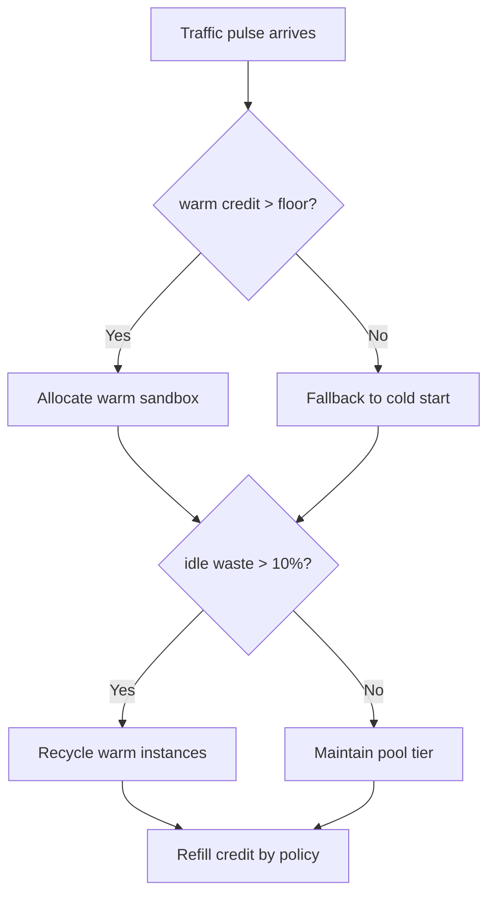
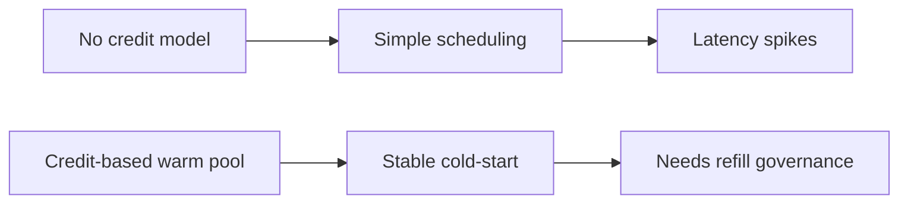
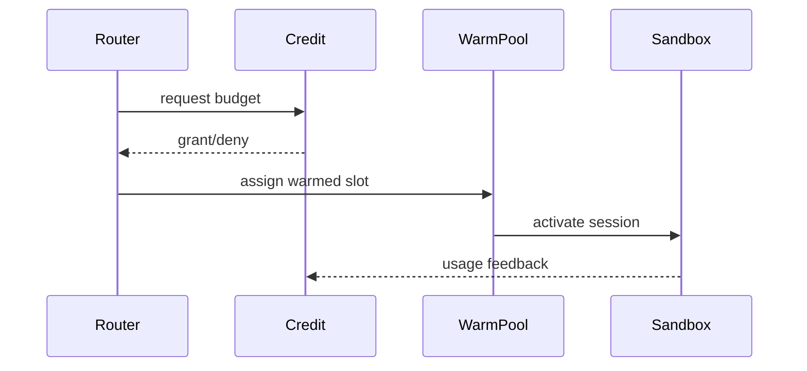

# Agent E2B Sandbox Warm Pool Credit Selection FAQ (Azure AI Agent Infra)

## 1) 3-minute conclusions
- **During E2B cold-start spikes, warm-pool credits are the key control for latency and spend.**
- **Use credit buckets + tiered prewarm + overspend reclamation.**
- **Targets: `cold_start_p95 <2.1s`, `credit_overspend <0.7%`, `idle_pool_waste <10%`.**

## 2) Q1 / Q2 / Q3
- **Why credits drift?** Traffic pulses and reclaim windows get out of phase.
- **Why not always prewarm everything?** Idle occupancy inflates cost.
- **Minimum loop?** Credit refill policy, priority allocation, reclaim thresholds.

### Q1: When to refill credits?
When hit ratio drops and cold starts rise.

### Q2: When to recycle warm instances?
When idle ratio exceeds threshold over sustained windows.

### Q3: How to measure gain?
Compare cold-start improvement against budget drift.

## 3) Mermaid diagrams
### 3.1 Decision tree

### 3.2 Path comparison

### 3.3 Sequence

## 4) Decision matrix
| Dimension | No-credit prewarm | Credit-bucket prewarm (Recommended) |
|---|---:|---:|
| Cold-start performance | Medium-low | High |
| Cost control | Low | High |
| Ops complexity (1-10) | 4 | 7 |
| Peak stability | Medium | High |
| Waste control | Medium-low | High |

## 5) Quant model + 7-card insights
- Gain: `LatencyGain = BaselineColdP95 - CreditColdP95`
- Overspend rate: `Overspend = CreditOver / CreditTotal`
- Example (`synthetic_assumed`):
  - `BaselineColdP95=3.4s, CreditColdP95=1.9s`
  - `LatencyGain=1.5s`
  - `CreditOver=680, CreditTotal=102,000`
  - `Overspend=0.67%`
- Evidence:
  - `workshops/azure-agent-infra/evidence/cycle-1484-benchmark.json`
  - `workshops/azure-agent-infra/evidence/cycle-1484-sources.json`
- Labels: `official/synthetic_assumed/not_measured`.

## 6) Production verification checklist
- [ ] Credit refill and debit accounting are consistent
- [ ] Warm recycle thresholds and anti-flap controls are active
- [ ] Overspend alerts and auto-throttle are available
- [ ] Cold-start and cost dashboards are linked
- [ ] FAQ/7-card source labels are complete
