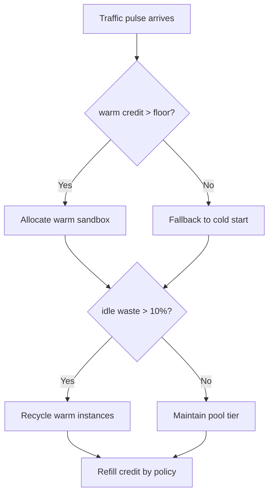
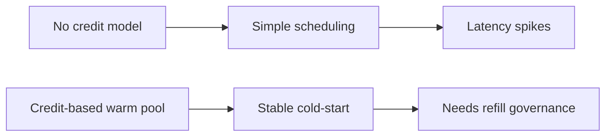
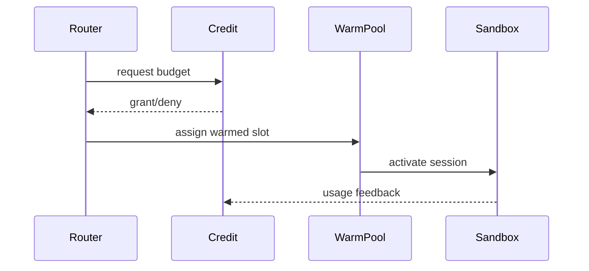

# Agent E2B Sandbox Warm Pool Credit 选型 FAQ（Azure AI Agent Infra）

## 1) 3 分钟结论
- **E2B 沙盒冷启动波峰时，warm pool credit 是控制成本与延迟的关键。**
- **推荐“信用桶 + 分层预热 + 超发回收”策略。**
- **目标阈值：`cold_start_p95 <2.1s`、`credit_overspend <0.7%`、`idle_pool_waste <10%`。**

## 2) Q1 / Q2 / Q3
- **为何 credit 会失控？**：流量脉冲与回收窗口错位。
- **为何不能无限预热？**：空闲占用推高总成本。
- **最小闭环？**：信用桶补给、优先级分配、回收阈值。

### Q1：何时补充信用？
命中率下降且冷启动上升时。

### Q2：何时回收预热实例？
空闲占比超过阈值并持续。

### Q3：如何衡量收益？
比较冷启动改善与预算偏差。

## 3) Mermaid 图
### 3.1 决策树

### 3.2 路径对比

### 3.3 时序

## 4) 决策矩阵
| 维度 | 无信用预热 | 信用桶预热（推荐） |
|---|---:|---:|
| 冷启动表现 | 中低 | 高 |
| 成本可控性 | 低 | 高 |
| 运维复杂度（1-10） | 4 | 7 |
| 峰值稳定性 | 中 | 高 |
| 资源浪费控制 | 中低 | 高 |

## 5) 定量算例与 7-Card 洞察
- 收益：`LatencyGain = BaselineColdP95 - CreditColdP95`
- 超发率：`Overspend = CreditOver / CreditTotal`
- 示例（`synthetic_assumed`）：
  - `BaselineColdP95=3.4s, CreditColdP95=1.9s`
  - `LatencyGain=1.5s`
  - `CreditOver=680, CreditTotal=102,000`
  - `Overspend=0.67%`
- 证据：
  - `workshops/azure-agent-infra/evidence/cycle-1484-benchmark.json`
  - `workshops/azure-agent-infra/evidence/cycle-1484-sources.json`
- 标签：`official/synthetic_assumed/not_measured`。

## 6) 生产核验 Checklist
- [ ] credit 桶补给与扣减口径一致
- [ ] 预热回收阈值和防抖策略启用
- [ ] 超发告警与自动压降可用
- [ ] 冷启动与成本指标联动看板完整
- [ ] FAQ/7-Card 来源标签完整
