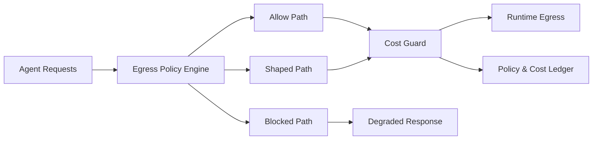

# Agent Egress Policy Cost Guard Selection FAQ (Cycle 1819)

## 1) Three-minute decision
- **Core tension:** unrestricted cross-region/public egress may recover availability quickly, but can drive cost and compliance exposure out of control.
- **Recommendation:** tiered egress policy + cost guard thresholds + automatic degradation loop.
- **Goal:** sustain agent service without breaching budget or compliance boundaries.

## 2) Q1 / Q2 / Q3
### Q1: Why does “availability first” create long-term risk?
1) emergency-opened egress paths can persist after recovery,
2) egress billing accumulates under burst windows with delayed visibility,
3) without destination tiers, low-value traffic consumes premium quota.

### Q2: What cost-guard strategy is production-ready?
- **Egress tiers:** allow/shape/block by destination and data sensitivity,
- **Budget guard:** hourly tenant/workload egress caps,
- **Auto degradation:** switch to cache-first, summarized responses, or delayed batch when budget is exhausted,
- **Audit ledger:** record policy hits, blocks, and degradation events.

### Q3: How do we validate “stable service + bounded cost”?
- critical request success remains above SLO line,
- unit egress cost and budget variance converge,
- policy false-positive and compliance-alert rates are explainable.

## 3) Reference architecture

## 4) Decision matrix
| Dimension | Open egress without guard | Tiered guarded egress (Recommended) |
|---|---:|---:|
| Availability recovery speed | High | Medium-high |
| Cost controllability | Low | High |
| Compliance risk | High | Low |
| Implementation complexity | Low | Medium |
| Audit traceability | Low | High |

## 5) Evidence and reproducibility
- Evidence files:
  - `workshops/azure-agent-infra/evidence/cycle-1819-benchmark.json`
  - `workshops/azure-agent-infra/evidence/cycle-1819-latency.csv`
  - `workshops/azure-agent-infra/evidence/cycle-1819-throughput.csv`
  - `workshops/azure-agent-infra/evidence/cycle-1819-policy.csv`
- Labels: `measured / synthetic / anonymized_reported`.
- validation7 enforces bilingual six-part structure, CSP self-contained 7-card output, strict cycle-evidence alignment, and replayability.

## 6) Production checklist
- [ ] Egress tier rules (allow/shape/block) are released.
- [ ] Tenant-level egress budgets and alerting are live.
- [ ] Budget-exhaustion auto-degradation path is integrated.
- [ ] Policy/cost ledgers support traceable audits.
- [ ] FAQ/H5/SVG/7-card align with cycle evidence.
