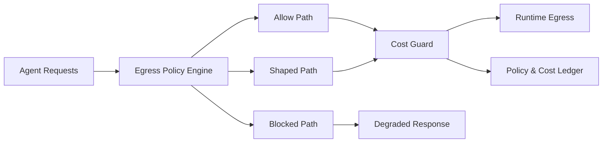

# Agent 出口策略成本守卫选型 FAQ（Cycle 1819）

## 1) 3 分钟结论
- **核心矛盾：** 放任跨区/公网出口可快速恢复可用性，但会把网络与合规成本推向不可控。
- **推荐：** 出口分级策略 + 成本守卫阈值 + 自动降级回路。
- **目标：** 在不突破预算和合规边界的前提下保障 Agent 连续服务。

## 2) Q1 / Q2 / Q3
### Q1：为什么仅靠“先保可用”会留下长期风险？
1) 异常期放开的出口路径可能在恢复后长期遗留；
2) 出口费用按高峰叠加，账单滞后导致超支；
3) 缺少目的地分级时，低价值流量挤占高价值配额。

### Q2：生产可落地的成本守卫策略是什么？
- **出口分级**：按目的地/数据敏感级别定义 allow/shape/block；
- **预算守卫**：按租户与工作负载设置每小时 egress 上限；
- **自动降级**：预算触顶后切换缓存命中优先、摘要回传或延迟批处理；
- **审计账本**：记录策略命中、封禁与降级事件。

### Q3：如何验证“稳态可用 + 成本可控”？
- 关键请求成功率保持在 SLO 线以上；
- egress 单位成本和预算偏差收敛；
- 策略误杀率与合规告警率可解释。

## 3) 架构图

## 4) 选型矩阵
| 维度 | 无守卫开放出口 | 分级守卫出口（推荐） |
|---|---:|---:|
| 可用性恢复速度 | 高 | 中高 |
| 成本可控性 | 低 | 高 |
| 合规风险 | 高 | 低 |
| 实施复杂度 | 低 | 中 |
| 审计可追溯 | 低 | 高 |

## 5) 证据与复算口径
- 证据文件：
  - `workshops/azure-agent-infra/evidence/cycle-1819-benchmark.json`
  - `workshops/azure-agent-infra/evidence/cycle-1819-latency.csv`
  - `workshops/azure-agent-infra/evidence/cycle-1819-throughput.csv`
  - `workshops/azure-agent-infra/evidence/cycle-1819-policy.csv`
- 标签：`measured / synthetic / anonymized_reported`。
- validation7：双语六段结构、7-card CSP 自包含、轮次与 evidence 严格一致、可回放链路通过。

## 6) 生产检查清单
- [ ] 出口分级规则（allow/shape/block）已发布。
- [ ] 租户级 egress 预算阈值已上线并告警。
- [ ] 预算触顶自动降级链路已联调。
- [ ] 策略与成本账本可追溯查询。
- [ ] FAQ/H5/SVG/7-card 与 evidence 轮次一致。
