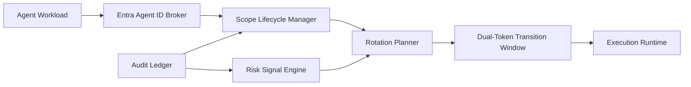

# Entra Agent ID Scope Rotation Selection FAQ (Cycle 1860)

## 1) Three-minute decision
- **Core tradeoff:** frequent scope rotation reduces long-lived privilege exposure, but overly aggressive rotation can introduce token-churn instability.
- **Recommendation:** tiered scope lifecycles (short high-sensitivity / medium standard), phased rollout, and dual-token transition windows.
- **Goal:** preserve call continuity while enforcing least-privilege rotation controls.

## 2) Q1 / Q2 / Q3
### Q1: Why is one-cycle global rotation suboptimal?
1) concurrent workloads trigger refresh storms,
2) sensitivity levels differ across scopes,
3) no overlap window amplifies short-term 401/403 spikes.

### Q2: What production-grade scope-rotation strategy should be used?
- **Tiered lifecycle:** short rotation for sensitive scopes, medium rotation for standard scopes,
- **Phased rollout:** tenant/app batches with staged observation,
- **Dual-token transition:** temporary old/new scope overlap for in-flight completion,
- **Risk trigger:** force early rotation and privilege tightening on anomaly signals.

### Q3: How do we validate strategy effectiveness?
- stable call success during rotation windows,
- lower 401/403 peaks and recovery time,
- reduced exposure duration for high-sensitivity scopes.

## 3) Reference architecture

## 4) Decision matrix
| Dimension | Uniform-cycle global rotation | Tiered phased rotation (Recommended) |
|---|---:|---:|
| Security convergence speed | Medium | High |
| Call continuity | Low | High |
| Recovery robustness | Low | High |
| Implementation complexity | Low | Medium |
| Operational observability | Medium | High |

## 5) Evidence and reproducibility
- Evidence files:
  - `workshops/azure-agent-infra/evidence/cycle-1860-benchmark.json`
  - `workshops/azure-agent-infra/evidence/cycle-1860-latency.csv`
  - `workshops/azure-agent-infra/evidence/cycle-1860-throughput.csv`
  - `workshops/azure-agent-infra/evidence/cycle-1860-policy.csv`
- Labels: `measured / synthetic / anonymized_reported`.
- validation7 enforces bilingual six-part structure, CSP self-contained 7-card output, strict cycle-evidence alignment, and replayability.

## 6) Production checklist
- [ ] Tiered scope lifecycle policy is frozen.
- [ ] Phased rotation batches and observation windows are configured.
- [ ] Dual-token transition remains stable under load.
- [ ] Risk-triggered early-rotation flow is replay-validated.
- [ ] FAQ/H5/SVG/7-card align with cycle evidence.
