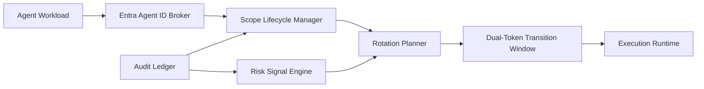

# Entra Agent ID Scope 轮换选型 FAQ（Cycle 1860）

## 1) 3 分钟结论
- **核心矛盾：** Scope 轮换频繁可降低长期权限暴露，但过快轮换会带来令牌失效抖动与调用中断。
- **推荐：** 分层 scope 生命周期（短期高敏/中期常规）+ 灰度轮换 + 双令牌过渡窗口。
- **目标：** 在最小权限治理下维持稳定调用连续性与低故障切换成本。

## 2) Q1 / Q2 / Q3
### Q1：为什么“统一周期全量轮换”不可取？
1) 高并发调用面会同时触发刷新风暴；
2) 不同 scope 敏感级别差异大，统一节奏不经济；
3) 缺少过渡窗口时会放大短时 401/403 错误。

### Q2：生产级 scope 轮换策略如何设计？
- **分层生命周期：** 高敏 scope 短周期轮换，常规 scope 中周期轮换；
- **灰度轮换：** 按租户/应用批次推进，逐批观测；
- **双令牌过渡：** 新旧 scope 并行短窗，确保在途请求完成；
- **风险触发：** 检测异常访问后可提前强制轮换并收紧权限。

### Q3：如何验证轮换策略有效？
- 轮换期间调用成功率保持稳定；
- 401/403 峰值与恢复时间下降；
- 高敏 scope 暴露时间显著缩短。

## 3) 架构图

## 4) 选型矩阵
| 维度 | 全量同周期轮换 | 分层灰度轮换（推荐） |
|---|---:|---:|
| 安全收敛速度 | 中 | 高 |
| 调用连续性 | 低 | 高 |
| 故障可恢复性 | 低 | 高 |
| 实施复杂度 | 低 | 中 |
| 运维可观测性 | 中 | 高 |

## 5) 证据与复算口径
- 证据文件：
  - `workshops/azure-agent-infra/evidence/cycle-1860-benchmark.json`
  - `workshops/azure-agent-infra/evidence/cycle-1860-latency.csv`
  - `workshops/azure-agent-infra/evidence/cycle-1860-throughput.csv`
  - `workshops/azure-agent-infra/evidence/cycle-1860-policy.csv`
- 标签：`measured / synthetic / anonymized_reported`。
- validation7：双语六段结构、7-card CSP 自包含、轮次与 evidence 一致、可回放链路通过。

## 6) 生产检查清单
- [ ] Scope 分层生命周期策略已固化。
- [ ] 灰度轮换批次与观察窗口已配置。
- [ ] 双令牌过渡窗口在压测下稳定。
- [ ] 风险触发提前轮换链路可回放。
- [ ] FAQ/H5/SVG/7-card 与 evidence 轮次一致。
