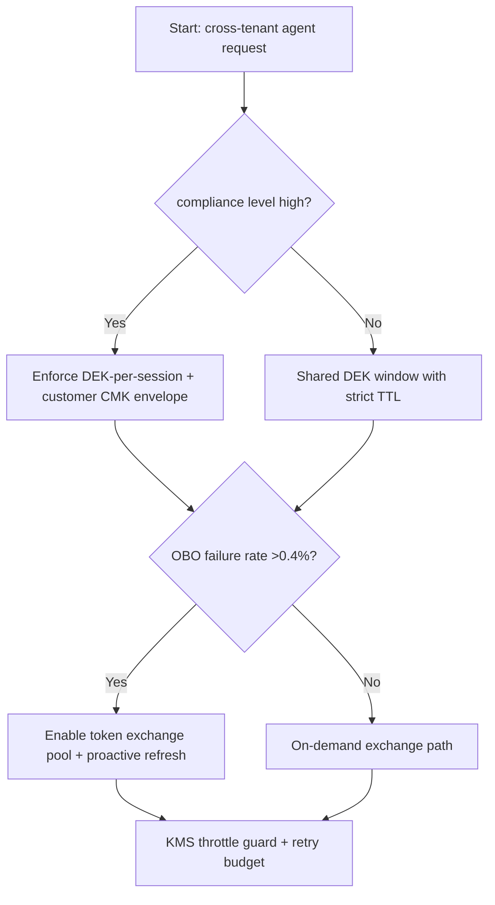
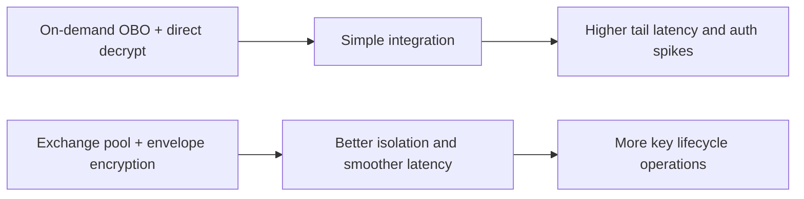
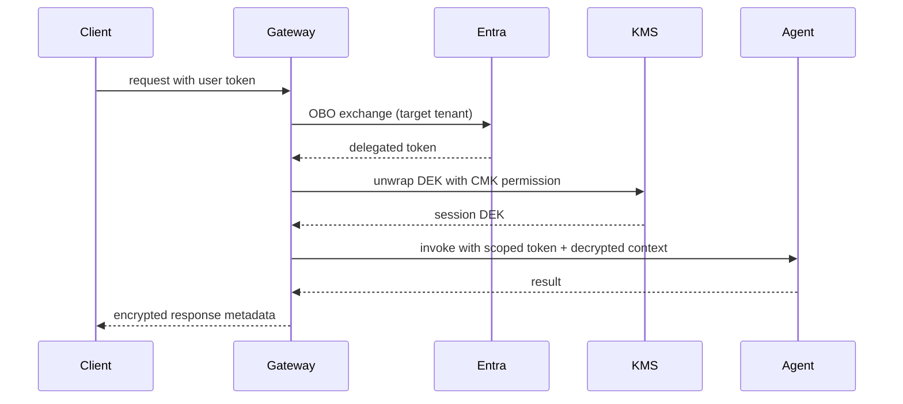

# Agent Entra OBO Cross-Tenant KMS Envelope Encryption Selection FAQ (Azure AI Agent Infra)

## 1) 3-minute conclusions
- **If OBO token-exchange failure rate exceeds 0.4% in cross-tenant paths, use a pre-authorized exchange pool with short TTL refresh** to avoid identity-service spikes on the request path.
- **For high-compliance cross-tenant data flows, enforce DEK-per-session plus least-privilege customer CMK envelope encryption**.
- **Key-governance safety outranks throughput gains**: when KMS throttles, degrade non-critical paths but never bypass encrypted writes.

## 2) Q1 / Q2 / Q3
- **Why does OBO jitter?** Long trust chains, multiple token issuers, and concurrent refresh contention.
- **Why envelope encryption?** It separates data-key material from master-key authority, reducing blast radius.
- **Minimum deployment loop?** Exchange pool, key rotation, failure replay, and auditable traceability.

### Q1: When is cross-tenant KMS mandatory?
When customer-owned keys must remain revocable within the customer tenant under regulatory controls.

### Q2: When is single-tenant CMK acceptable?
Only for low-sensitivity internal workloads without cross-jurisdiction requirements.

### Q3: How to size capacity?
Plan against `token_refresh_qps`, `kms_unwrap_qps`, and `retry_budget`, then reserve 30% headroom.

## 3) Mermaid diagrams
### 3.1 Decision tree

### 3.2 Path comparison

### 3.3 Sequence

## 4) Decision matrix
| Dimension | On-demand exchange + direct decrypt | Exchange pool + envelope encryption (Recommended) |
|---|---:|---:|
| Request latency P95 | 480–820ms | 230–460ms |
| OBO failure amplification | 1.8x–2.4x | 1.1x–1.5x |
| Key isolation strength | Medium | High |
| Audit traceability | Medium | High |
| Implementation complexity (1-10) | 5 | 8 |
| Compliance readiness | Moderate | Strong |

## 5) Quant model + 7-card insights
- End-to-end latency: `E2E = OBO + KMS_Unwrap + Agent_Runtime + RetryPenalty`
- Per-session encryption overhead: `EncryptCost = KMSOps * KMSUnitPrice + RetryOps * RetryUnit`
- Example (`synthetic_assumed`):
  - `OBO=180ms, KMS_Unwrap=95ms, Agent_Runtime=130ms, RetryPenalty=40ms`
  - `E2E=445ms`
  - `KMSOps=3, KMSUnitPrice=$0.000003, RetryOps=0.4, RetryUnit=$0.000002`
  - `EncryptCost=$0.0000098/session`
- Evidence:
  - `workshops/azure-agent-infra/evidence/cycle-1450-benchmark.json`
  - `workshops/azure-agent-infra/evidence/cycle-1450-sources.json`
- Labels: `official` / `synthetic_assumed` / `not_measured`.

## 6) Production verification checklist
- [ ] Exchange-pool TTL, concurrency limits, and circuit breakers are configured
- [ ] DEK derivation and CMK least-privilege grants passed audit review
- [ ] KMS 429/5xx degrade path and retry-budget protection are tested
- [ ] Identity and key chains are traceable with request-level IDs
- [ ] Source labels are complete across docs and 7-card outputs
