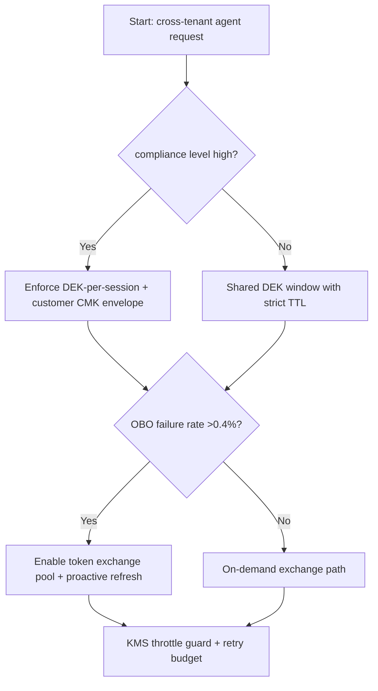
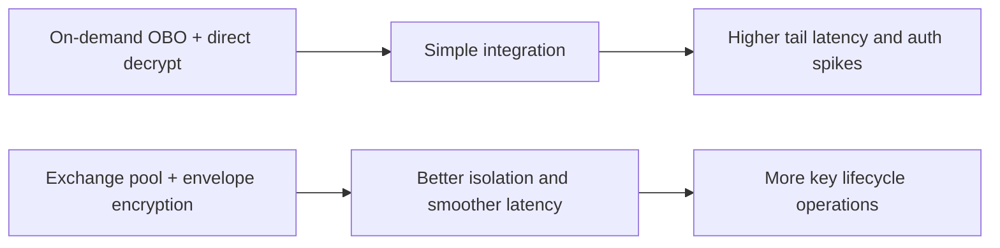
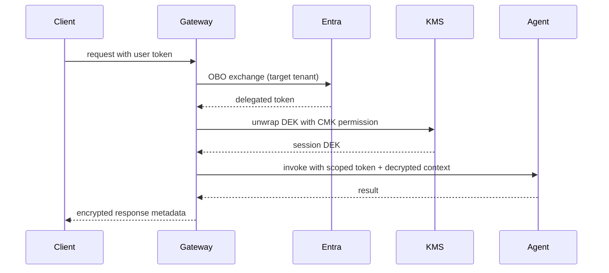

# Agent Entra OBO Cross-Tenant KMS Envelope Encryption 选型 FAQ（Azure AI Agent Infra）

## 1) 3 分钟结论
- **若跨租户调用链中 OBO token 交换失败率 >0.4%，优先引入“预授权 token 交换池 + 短 TTL 刷新”**，避免请求路径实时打满身份服务。
- **当数据跨租户传递且合规级别为高（金融/政务），必须采用“DEK 每会话派生 + CMK 跨租户授权最小化”信封加密**。
- **密钥治理优先级高于吞吐优化**：出现 KMS 429 时应降级非关键路径，不可跳过加密写入。

## 2) Q1 / Q2 / Q3
- **为什么 OBO 会抖动？**：跨租户信任链长、令牌签发端点多、并发刷新冲突。
- **为什么信封加密是必选？**：把“数据密钥”和“主密钥权限”拆开，降低单点泄露半径。
- **最小上线闭环？**：身份交换池、密钥轮换、失败重放、审计追溯四件套。

### Q1：何时必须跨租户 KMS？
当客户主密钥托管在其租户且法规要求“客户可撤销访问”时。

### Q2：何时可用单租户 CMK？
仅在内部低敏场景且无跨法域数据要求时。

### Q3：如何做容量规划？
基于 `token_refresh_qps`、`kms_unwrap_qps`、`retry_budget` 估算峰值并预留 30% 裕量。

## 3) Mermaid 图
### 3.1 选型决策树

### 3.2 路径对比

### 3.3 时序

## 4) 决策矩阵
| 维度 | 按需交换 + 直解密 | 交换池 + 信封加密（推荐） |
|---|---:|---:|
| 请求 P95 延迟 | 480–820ms | 230–460ms |
| OBO 失败放大 | 1.8x–2.4x | 1.1x–1.5x |
| 密钥隔离强度 | 中 | 高 |
| 审计可追溯性 | 中 | 高 |
| 实施复杂度（1-10） | 5 | 8 |
| 合规适配 | 一般 | 强 |

## 5) 定量算例与 7-Card 洞察
- 端到端延迟：`E2E = OBO + KMS_Unwrap + Agent_Runtime + RetryPenalty`
- 单会话加密成本：`EncryptCost = KMSOps * KMSUnitPrice + RetryOps * RetryUnit`
- 示例（`synthetic_assumed`）：
  - `OBO=180ms, KMS_Unwrap=95ms, Agent_Runtime=130ms, RetryPenalty=40ms`
  - `E2E=445ms`
  - `KMSOps=3, KMSUnitPrice=$0.000003, RetryOps=0.4, RetryUnit=$0.000002`
  - `EncryptCost=$0.0000098/session`
- 证据：
  - `workshops/azure-agent-infra/evidence/cycle-1450-benchmark.json`
  - `workshops/azure-agent-infra/evidence/cycle-1450-sources.json`
- 标注：`official` / `synthetic_assumed` / `not_measured`。

## 6) 生产核验 Checklist
- [ ] OBO 交换池 TTL、并发上限、熔断策略已配置
- [ ] DEK 会话派生与 CMK 授权最小化策略通过审计
- [ ] KMS 429/5xx 场景具备降级与重试预算保护
- [ ] 身份链路与密钥链路均有 request-id 级追踪
- [ ] 文档与 7-Card 全字段来源标签齐全
