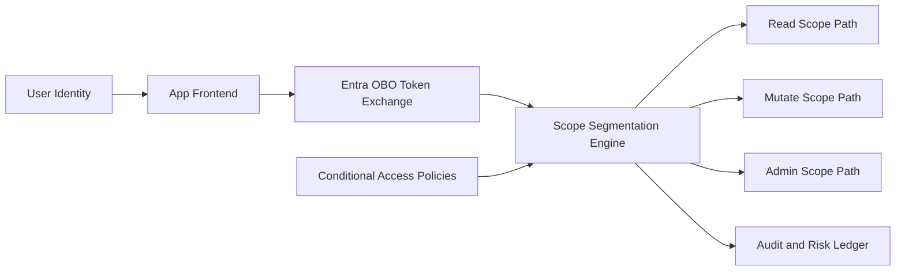

# Entra OBO Scope Segmentation Selection FAQ (Cycle 1839)

## 1) Three-minute decision
- **Main challenge:** in multi-tenant OBO chains, broad scopes enlarge lateral-risk surfaces, while overly narrow scopes cause frequent token-exchange failures.
- **Recommendation:** segment scopes by capability, isolate audiences, and bind conditional-access policies.
- **Goal:** keep least-privilege guarantees without sacrificing runtime availability.

## 2) Q1 / Q2 / Q3
### Q1: Why is broad all-in scope assignment unsafe?
1) token leakage exposes more APIs,
2) audit trails cannot map calls to clear intent,
3) high-privilege scopes plus token reuse increase misuse risk.

### Q2: What is a production-ready OBO scope segmentation pattern?
- **Capability segmentation:** read, mutate, and admin tiers,
- **Audience isolation:** isolate by API audience and tenant boundary,
- **Policy binding:** attach conditional access to sensitive scopes,
- **Fallback path:** degrade to lower-privilege read path when high-privilege scopes fail.

### Q3: How do we validate segmentation value?
- token exchange success remains within SLO range,
- unauthorized alerts and denies decline,
- high-privilege usage share is explainable and auditable.

## 3) Reference architecture

## 4) Decision matrix
| Dimension | Broad all-access scope | Segmented least-privilege OBO (Recommended) |
|---|---:|---:|
| Security boundary | Low | High |
| Availability | Medium | Medium-high |
| Audit explainability | Low | High |
| Integration complexity | Low | Medium |
| Compliance readiness | Low | High |

## 5) Evidence and reproducibility
- Evidence files:
  - `workshops/azure-agent-infra/evidence/cycle-1839-benchmark.json`
  - `workshops/azure-agent-infra/evidence/cycle-1839-latency.csv`
  - `workshops/azure-agent-infra/evidence/cycle-1839-throughput.csv`
  - `workshops/azure-agent-infra/evidence/cycle-1839-policy.csv`
- Labels: `measured / synthetic / anonymized_reported`.
- validation7 enforces bilingual six-part structure, CSP self-contained 7-card output, strict cycle-evidence alignment, and replayability.

## 6) Production checklist
- [ ] OBO scope segmentation model is versioned.
- [ ] Audience and tenant-isolation rules are active.
- [ ] Conditional-access policies are bound to sensitive scopes.
- [ ] High-privilege failure fallback to read-only is validated.
- [ ] FAQ/H5/SVG/7-card align with cycle evidence.
