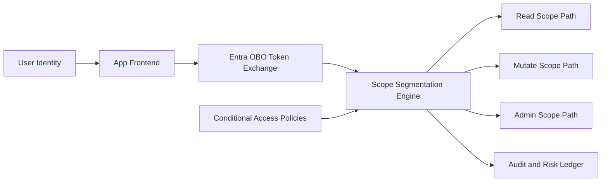

# Entra OBO Scope 分段选型 FAQ（Cycle 1839）

## 1) 3 分钟结论
- **核心挑战：** 多租户 Agent 在 OBO（On-Behalf-Of）链路中若 scope 过宽，会放大横向访问风险；过窄则增加令牌交换失败。
- **推荐：** 按业务能力分段 scope（读/写/运维）+ 受众隔离 + 条件访问联动。
- **目标：** 在最小权限前提下保持可用性，避免跨租户越权与频繁授权重试。

## 2) Q1 / Q2 / Q3
### Q1：为什么“一把梭全量 scope”不可取？
1) 令牌一旦泄露，攻击面覆盖更多 API；
2) 审计追踪难以区分真实业务调用意图；
3) 高权限 scope 叠加缓存复用会增加误用概率。

### Q2：生产可落地的 OBO scope 分段模式是什么？
- **能力分段：** 将 scope 划分为 read / mutate / admin 三级；
- **受众隔离：** 按 API audience 与租户边界拆分；
- **策略联动：** 条件访问（设备、地点、风险）绑定高敏 scope；
- **降级回退：** 高敏 scope 失败时自动回退到低权限只读路径。

### Q3：如何衡量分段策略效果？
- 令牌交换成功率维持在目标区间；
- 越权告警与拒绝率下降；
- 高权限调用占比可解释且可审计。

## 3) 架构图

## 4) 选型矩阵
| 维度 | 全量宽 scope | 分段最小权限 OBO（推荐） |
|---|---:|---:|
| 安全边界 | 低 | 高 |
| 可用性 | 中 | 中高 |
| 审计可解释性 | 低 | 高 |
| 集成复杂度 | 低 | 中 |
| 合规适配 | 低 | 高 |

## 5) 证据与复算口径
- 证据文件：
  - `workshops/azure-agent-infra/evidence/cycle-1839-benchmark.json`
  - `workshops/azure-agent-infra/evidence/cycle-1839-latency.csv`
  - `workshops/azure-agent-infra/evidence/cycle-1839-throughput.csv`
  - `workshops/azure-agent-infra/evidence/cycle-1839-policy.csv`
- 标签：`measured / synthetic / anonymized_reported`。
- validation7：双语六段结构、7-card CSP 自包含、轮次与 evidence 一致、可回放链路通过。

## 6) 生产检查清单
- [ ] OBO scope 分段模型已完成并版本化。
- [ ] audience 与租户隔离规则生效。
- [ ] 条件访问策略已绑定高敏 scope。
- [ ] 高敏失败降级只读链路已演练。
- [ ] FAQ/H5/SVG/7-card 与 evidence 轮次一致。
