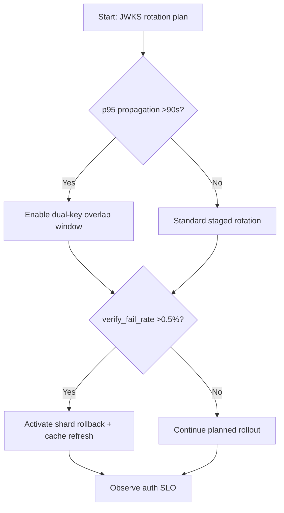
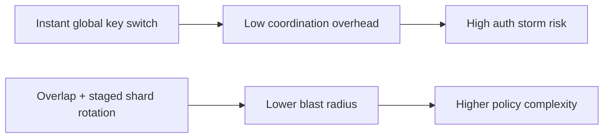
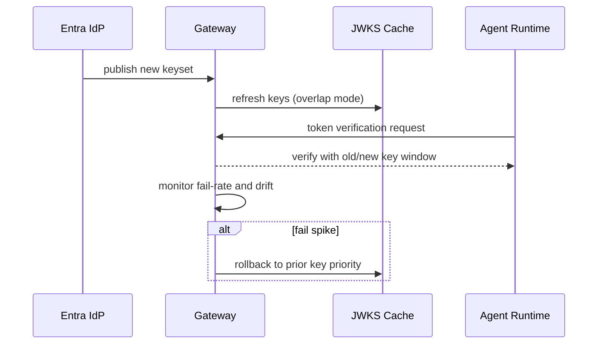

# Agent Entra Workload Identity JWKS Rotation Blast Radius Selection FAQ (Azure AI Agent Infra)

## 1) 3-minute conclusions
- **If JWKS rotation propagation P95 exceeds 90s and verification failures exceed 0.5%, enforce dual-key overlap with staged invalidation.**
- **In multi-region clusters, a single global key cutover amplifies 401 storms; use gradual shard rotation with tenant-scoped rollback.**
- **Production boundary: `overlap_window >= 2 * p95_propagation`, with recovery within 3 minutes.**

## 2) Q1 / Q2 / Q3
- **Why does rotation trigger auth avalanche?** Verifier cache lag, long JWKS TTL, and clock skew.
- **Why dual-key overlap?** It keeps old/new tokens valid during propagation windows.
- **Minimum viable loop?** Rotation plan, staged release, failure budget, and automated rollback.

### Q1: When must JWKS cache TTL be reduced?
When `key_miss_rate >0.4%` and cross-region propagation exceeds 60s.

### Q2: When is immediate full rotation acceptable?
Only in single-region, single-cluster, low-concurrency validation environments.

### Q3: How to evaluate risk?
Estimate blast radius as potential failed requests times per-request business loss.

## 3) Mermaid diagrams
### 3.1 Decision tree

### 3.2 Path comparison

### 3.3 Sequence

## 4) Decision matrix
| Dimension | Instant full rotation | Overlap + staged shards (Recommended) |
|---|---:|---:|
| Peak auth failures | 0.8%–3.2% | 0.1%–0.6% |
| Rollback controllability | Low | High |
| Rotation duration | Short | Medium |
| Ops complexity (1-10) | 4 | 8 |
| Blast radius | High | Low |

## 5) Quant model + 7-card insights
- Blast radius: `Blast = FailedAuthReq * LossPerReq`
- Safety window: `OverlapWindow >= 2 * PropagationP95`
- Example (`synthetic_assumed`):
  - `FailedAuthReq=24,000/h, LossPerReq=$0.0009`
  - `Blast=$21.6/h`
  - `PropagationP95=72s`
  - `OverlapWindow>=144s`
- Evidence:
  - `workshops/azure-agent-infra/evidence/cycle-1457-benchmark.json`
  - `workshops/azure-agent-infra/evidence/cycle-1457-sources.json`
- Labels: `official/synthetic_assumed/not_measured`.

## 6) Production verification checklist
- [ ] JWKS dual-key overlap window aligns with token TTL
- [ ] Cache refresh, rollback, and alert pipeline are drill-validated
- [ ] Shard rollout supports tenant/region fast stop-loss
- [ ] Auth failure budgets and SLO gates are configured
- [ ] FAQ/7-card source labels are complete
