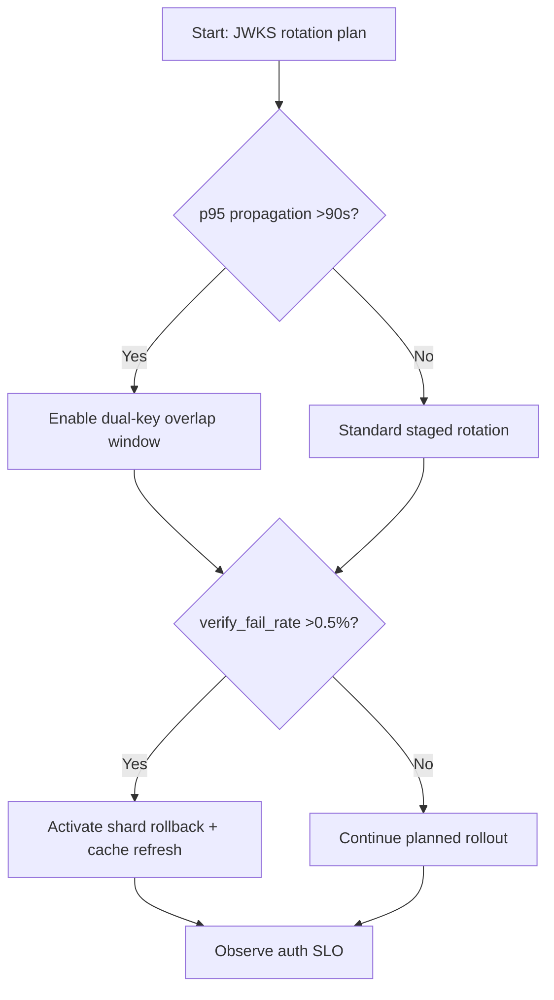
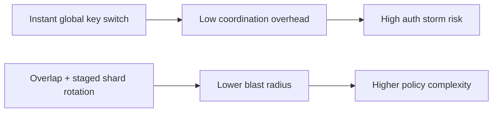
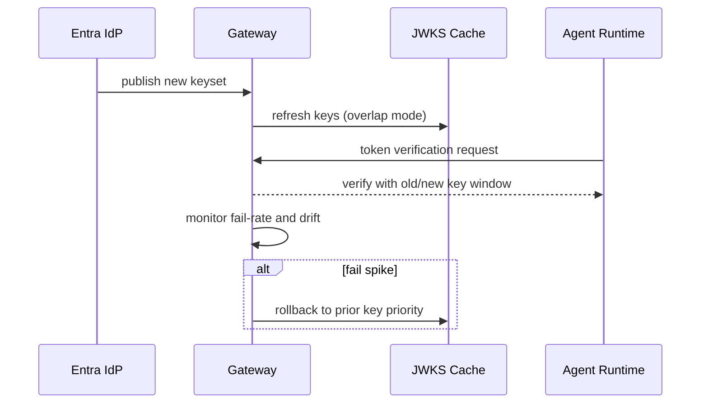

# Agent Entra Workload Identity JWKS Rotation Blast Radius 选型 FAQ（Azure AI Agent Infra）

## 1) 3 分钟结论
- **当 JWKS 轮换传播延迟 P95 >90s 且验证失败率 >0.5% 时，必须启用“双密钥重叠窗口 + 分批失效”策略。**
- **跨区域多集群场景下，统一瞬时切换公钥会放大 401 风暴；应采用灰度轮换和租户分片回滚。**
- **生产分界线：`overlap_window >= 2 * p95_propagation`，且回滚链路在 3 分钟内可恢复。**

## 2) Q1 / Q2 / Q3
- **为什么 JWKS 一轮换就出现认证雪崩？**：验证方缓存未同步、公钥 TTL 过长、时钟漂移叠加。
- **为什么要双密钥重叠？**：避免新旧 token 在传播窗口内互相拒绝。
- **最小闭环？**：轮换计划、灰度发布、失败预算、自动回滚。

### Q1：什么时候必须缩短 JWKS 缓存 TTL？
当 `key_miss_rate >0.4%` 且跨区传播超过 60 秒。

### Q2：什么时候允许全量即时轮换？
仅单区域、单集群、低并发验证环境。

### Q3：如何评估轮换风险？
用“潜在失败请求数 × 单请求业务损失”量化 blast radius。

## 3) Mermaid 图
### 3.1 决策树

### 3.2 路径对比

### 3.3 时序

## 4) 决策矩阵
| 维度 | 即时全量轮换 | 重叠窗口+分片灰度（推荐） |
|---|---:|---:|
| 认证失败峰值 | 0.8%–3.2% | 0.1%–0.6% |
| 回滚可控性 | 低 | 高 |
| 轮换时长 | 短 | 中 |
| 运维复杂度（1-10） | 4 | 8 |
| 爆炸半径 | 高 | 低 |

## 5) 定量算例与 7-Card 洞察
- 爆炸半径：`Blast = FailedAuthReq * LossPerReq`
- 安全窗口：`OverlapWindow >= 2 * PropagationP95`
- 示例（`synthetic_assumed`）：
  - `FailedAuthReq=24,000/h, LossPerReq=$0.0009`
  - `Blast=$21.6/h`
  - `PropagationP95=72s`
  - `OverlapWindow>=144s`
- 证据：
  - `workshops/azure-agent-infra/evidence/cycle-1457-benchmark.json`
  - `workshops/azure-agent-infra/evidence/cycle-1457-sources.json`
- 标签：`official/synthetic_assumed/not_measured`。

## 6) 生产核验 Checklist
- [ ] JWKS 双密钥重叠窗口与 token TTL 对齐
- [ ] 缓存刷新、回滚、告警链路全自动演练通过
- [ ] 分片灰度策略支持按租户/区域快速止损
- [ ] 认证失败预算与 SLO 门禁已配置
- [ ] FAQ/7-Card 来源标注完整
