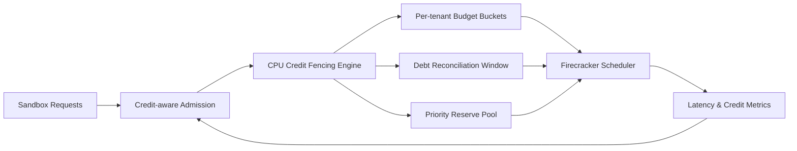

# Firecracker CPU Credit Fencing Selection FAQ (Cycle 1897)

## 1) Three-minute decision
- **Core issue:** under bursty mixed workloads, Firecracker CPU credits can be exhausted by hot tenants and amplify tail latency across the fleet.
- **Recommendation:** use credit budget fences, debt-reconciliation windows, and priority reserve pools.
- **Goal:** contain cross-tenant contention spillover while stabilizing critical latency and throughput.

## 2) Q1 / Q2 / Q3
### Q1: Why are CPU credits a multi-tenant risk source?
1) burst workloads rapidly drain shared credits,
2) without budget boundaries, heavy tenants can monopolize compute,
3) overdraft recovery windows can trigger cascading timeouts.

### Q2: How should production credit fencing be implemented?
- **Budget fences:** set per-tenant and per-class credit caps/rates,
- **Debt reconciliation:** pay back excess credits in staged windows,
- **Reserve pool:** guarantee minimum credits for critical traffic,
- **Scheduler coupling:** use credit health score at admission.

### Q3: What is the go-live bar?
- converged P95/P99 on critical paths,
- predictable debt peaks and recovery duration,
- no major per-throughput cost regression from fencing controls.

## 3) Reference architecture

## 4) Decision matrix
| Dimension | No credit fences | Credit Fencing (Recommended) |
|---|---:|---:|
| Multi-tenant fairness | Low | High |
| Tail-latency stability | Low | High |
| Fault isolation | Medium | High |
| Implementation complexity | Low | Medium |
| Cost predictability | Medium | High |

## 5) Evidence and reproducibility
- Evidence files:
  - `workshops/azure-agent-infra/evidence/cycle-1897-benchmark.json`
  - `workshops/azure-agent-infra/evidence/cycle-1897-latency.csv`
  - `workshops/azure-agent-infra/evidence/cycle-1897-throughput.csv`
  - `workshops/azure-agent-infra/evidence/cycle-1897-cost.csv`
- Labels: `measured / synthetic / anonymized_reported`.
- Validation chain: six-part FAQ, CSP, cycle/topic binding, simulator checks.

## 6) Production checklist
- [ ] Credit quota policies are fixed by tenant and class.
- [ ] Debt reconciliation windows pass peak-load tests.
- [ ] Reserve pool capacity aligns with critical SLOs.
- [ ] Admission integrates credit health scoring.
- [ ] FAQ/H5/SVG/7-card/evidence remain cycle-consistent.
