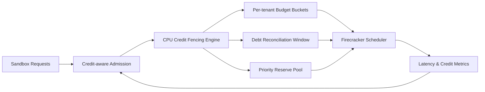

# Firecracker CPU Credit Fencing 选型 FAQ（Cycle 1897）

## 1) 3 分钟结论
- **核心问题：** Firecracker 节点在突发混部下，CPU credit 被热点租户透支后会引发整体尾延迟放大。
- **推荐方案：** “credit 预算围栏 + 债务回补窗口 + 优先级保底池”三段式治理。
- **目标：** 控制租户间争用外溢，稳定关键链路延迟与吞吐。

## 2) Q1 / Q2 / Q3
### Q1：CPU credit 为什么会成为多租户风险源？
1) burst 工作负载会快速耗尽共享 credit；
2) 无预算边界时高压租户可长期挤占计算；
3) credit 透支恢复期间易触发连锁超时。

### Q2：生产级 credit fencing 应怎么做？
- **预算围栏：** 按租户和 class 设 credit 上限与速率限制；
- **债务回补：** 超额 credit 在后续窗口分段回补；
- **保底池：** 关键流量拥有最小 credit 保障；
- **调度联动：** admission 阶段读取 credit 健康分数。

### Q3：上线判据是什么？
- 关键业务 P95/P99 明显收敛；
- credit 债务峰值与恢复时长可预测；
- 单位吞吐成本不因围栏机制明显上升。

## 3) 架构图

## 4) 选型矩阵
| 维度 | 无 credit 围栏 | Credit Fencing（推荐） |
|---|---:|---:|
| 多租户公平性 | 低 | 高 |
| 尾延迟稳定性 | 低 | 高 |
| 故障隔离能力 | 中 | 高 |
| 实施复杂度 | 低 | 中 |
| 成本可预测性 | 中 | 高 |

## 5) 证据与复算口径
- 证据文件：
  - `workshops/azure-agent-infra/evidence/cycle-1897-benchmark.json`
  - `workshops/azure-agent-infra/evidence/cycle-1897-latency.csv`
  - `workshops/azure-agent-infra/evidence/cycle-1897-throughput.csv`
  - `workshops/azure-agent-infra/evidence/cycle-1897-cost.csv`
- 标签：`measured / synthetic / anonymized_reported`。
- 校验链：FAQ 六段、CSP、cycle/topic 绑定、模拟器检查。

## 6) 生产检查清单
- [ ] credit 配额策略已按租户与 class 固化。
- [ ] 债务回补窗口通过峰值压测。
- [ ] 保底池容量与关键业务 SLO 对齐。
- [ ] admission 与 credit 健康评分联调完成。
- [ ] FAQ/H5/SVG/7-card/evidence 轮次一致。
