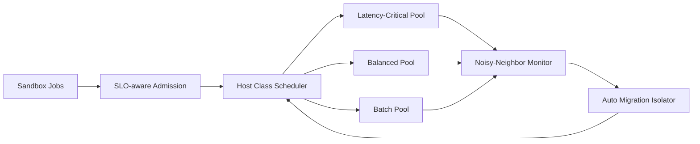

# Firecracker Host Class Noisy-Neighbor SLO Selection FAQ (Cycle 1893)

## 1) Three-minute decision
- **Core issue:** in multi-tenant Firecracker nodes, poor host-class placement causes noisy-neighbor interference, inflating tail latency and hurting SLOs.
- **Recommendation:** combine host-class tiers, interference budgets, and automatic migration isolation.
- **Goal:** improve node utilization while stabilizing latency and throughput for critical tenants.

## 2) Q1 / Q2 / Q3
### Q1: Why is noisy-neighbor impact pronounced in Firecracker workloads?
1) short and long jobs contend for CPU and IO,
2) burst traffic creates shared-resource jitter,
3) scheduling cannot contain interference without host-class policy.

### Q2: How should production host-class design work?
- **Tiered host classes:** latency-critical / balanced / batch pools,
- **Interference budgets:** define acceptable jitter thresholds per class,
- **Auto migration:** isolate high-interference instances when thresholds breach,
- **Scheduling constraints:** bind tenant SLO profiles to host classes at admission.

### Q3: What is the go-live bar?
- predictable and convergent P95/P99 on critical paths,
- controlled recovery time after interference alerts,
- no significant utilization collapse from isolation policies.

## 3) Reference architecture

## 4) Decision matrix
| Dimension | No host-class tiering | Host Class + Isolation (Recommended) |
|---|---:|---:|
| SLO stability | Low | High |
| Interference recovery | Low | High |
| Node utilization | Medium | High |
| Implementation complexity | Low | Medium |
| Operational explainability | Medium | High |

## 5) Evidence and reproducibility
- Evidence files:
  - `workshops/azure-agent-infra/evidence/cycle-1893-benchmark.json`
  - `workshops/azure-agent-infra/evidence/cycle-1893-latency.csv`
  - `workshops/azure-agent-infra/evidence/cycle-1893-throughput.csv`
  - `workshops/azure-agent-infra/evidence/cycle-1893-policy.csv`
- Labels: `measured / synthetic / anonymized_reported`.
- Validation chain: six-part FAQ, CSP, cycle/topic binding, and simulator checks.

## 6) Production checklist
- [ ] Host-class tiers and tenant label mapping are finalized.
- [ ] Interference budgets and alerts are load-tested.
- [ ] Auto migration has rollback and cooldown controls.
- [ ] Critical SLO metrics are on the shared dashboard.
- [ ] FAQ/H5/SVG/7-card/evidence are cycle-consistent.
