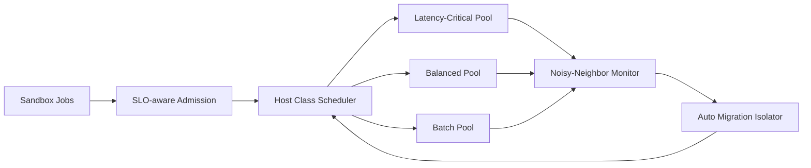

# Firecracker Host Class Noisy-Neighbor SLO 选型 FAQ（Cycle 1893）

## 1) 3 分钟结论
- **核心问题：** Firecracker 多租户节点中，host class 混部不当会引发 noisy-neighbor 干扰，拉高尾延迟并损伤 SLO。
- **推荐方案：** “host class 分层 + 干扰预算 + 自动迁移隔离”三件套。
- **目标：** 在提高节点利用率的同时稳定关键租户延迟与吞吐。

## 2) Q1 / Q2 / Q3
### Q1：noisy-neighbor 在 Firecracker 场景为何突出？
1) 短任务与长任务混布会抢占 CPU 与 IO；
2) 峰值突发导致共享资源抖动；
3) 缺乏 host class 规则时调度难以约束干扰。

### Q2：生产级 host class 体系如何设计？
- **分层 host class：** latency-critical / balanced / batch 三类节点池；
- **干扰预算：** 为每类池设定可接受抖动阈值；
- **自动迁移：** 触发阈值后迁移高干扰实例；
- **调度约束：** admission 时按租户 SLO 绑定 class。

### Q3：上线判据是什么？
- 关键路径 P95/P99 收敛且可预测；
- 干扰告警触发后恢复时间可控；
- 节点利用率不因隔离策略显著下滑。

## 3) 架构图

## 4) 选型矩阵
| 维度 | 无 host class 分层 | Host Class + Isolation（推荐） |
|---|---:|---:|
| SLO 稳定性 | 低 | 高 |
| 干扰恢复能力 | 低 | 高 |
| 节点利用率 | 中 | 高 |
| 实施复杂度 | 低 | 中 |
| 运维可解释性 | 中 | 高 |

## 5) 证据与复算口径
- 证据文件：
  - `workshops/azure-agent-infra/evidence/cycle-1893-benchmark.json`
  - `workshops/azure-agent-infra/evidence/cycle-1893-latency.csv`
  - `workshops/azure-agent-infra/evidence/cycle-1893-throughput.csv`
  - `workshops/azure-agent-infra/evidence/cycle-1893-policy.csv`
- 标签：`measured / synthetic / anonymized_reported`。
- 校验链：FAQ 六段、CSP、cycle/topic 绑定、模拟器检查。

## 6) 生产检查清单
- [ ] host class 分层定义与租户标签映射完成。
- [ ] 干扰预算阈值与告警策略已压测。
- [ ] 自动迁移策略具备回滚和冷却窗口。
- [ ] 关键 SLO 指标纳入统一看板。
- [ ] FAQ/H5/SVG/7-card/evidence 轮次一致。
