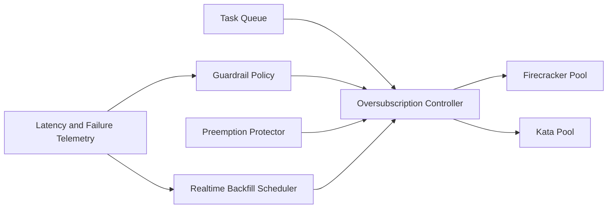

# Firecracker/Kata Oversubscription Guardrails Selection FAQ (Cycle 1872)

## 1) Three-minute decision
- **Core issue:** aggressive oversubscription can cause preemption jitter and tail-latency instability during sandbox peaks.
- **Recommendation:** combine tiered oversubscription ratios, preemption-protection thresholds, and real-time backfill scheduling.
- **Goal:** raise utilization while maintaining isolation stability and bounded P95/P99 latency.

## 2) Q1 / Q2 / Q3
### Q1: Why is a single oversubscription ratio unsafe?
1) CPU and memory stress curves diverge,
2) workloads tolerate jitter differently,
3) peak failures can turn a single ratio into systemic risk.

### Q2: How should production guardrails be implemented?
- **Tiered ratios:** set oversubscription caps by tenant tier and workload class,
- **Preemption protection:** reserve minima and preemption thresholds for critical sessions,
- **Backfill scheduling:** refill with low-priority jobs in safe windows,
- **Circuit controls:** auto-load-shed and scale triggers on tail-latency breaches.

### Q3: What is the go-live bar?
- bounded P95/P99 latency under target oversubscription,
- no material increase in session failure or policy false kills,
- stable scaling behavior in stress tests.

## 3) Reference architecture

## 4) Decision matrix
| Dimension | Fixed oversubscription | Tiered guardrail oversubscription (Recommended) |
|---|---:|---:|
| Resource utilization | Medium | High |
| Tail-latency controllability | Low | High |
| Isolation stability | Medium | High |
| Implementation complexity | Low | Medium |
| Operational observability | Medium | High |

## 5) Evidence and reproducibility
- Evidence files:
  - `workshops/azure-agent-infra/evidence/cycle-1872-benchmark.json`
  - `workshops/azure-agent-infra/evidence/cycle-1872-latency.csv`
  - `workshops/azure-agent-infra/evidence/cycle-1872-throughput.csv`
  - `workshops/azure-agent-infra/evidence/cycle-1872-policy.csv`
- Labels: `measured / synthetic / anonymized_reported`.
- validation7 enforces six-part structure, CSP-safe 7-card output, strict cycle-topic alignment, and replayable checks.

## 6) Production checklist
- [ ] Tiered oversubscription models are mapped by tenant/workload.
- [ ] Preemption thresholds and reserve minima pass load tests.
- [ ] Backfill scheduling and circuit controls pass drills.
- [ ] Tail-latency breach triggers load-shed as expected.
- [ ] FAQ/H5/SVG/7-card/evidence remain cycle-consistent.
